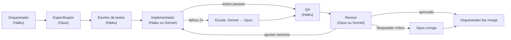

# Execução no Claude Code: Estratégia de Modelos e Configuração

> Complemento do plano mestre (`implementation_plan.md`, seção 9). Define **como** a equipe de agentes roda no Claude Code com a assinatura Claude, gastando o mínimo possível de modelos caros sem perder qualidade. **Nada aqui foi criado no disco ainda.** São as especificações dos arquivos que o Orquestrador vai gerar na fatia F0-S00.

---

## 1. Princípio central: "caro pensa e julga, barato executa"

A forma mais eficiente de usar modelos diferentes **não é** deixar o barato tentar sozinho e o caro consertar depois. Consertar código ruim custa mais que escrever certo. A estratégia é:

1. **O modelo caro (Opus) escreve a especificação** de cada fatia, uma vez só: interfaces, arquivos, testes de aceite, armadilhas. Isso custa pouco, porque é texto curto e de alto valor.
2. **Os testes são escritos antes do código** (por um modelo barato, a partir da especificação). Eles viram o "juiz objetivo".
3. **O modelo barato (Haiku/Sonnet) implementa** até os testes passarem.
4. **O modelo caro (Opus) revisa o diff**, que é curto, e não o projeto inteiro. Ele corrige diretamente só o que for crítico. O resto volta para o barato com instruções precisas.



---

## 2. Hierarquia de modelos

| Nível | Modelo (alias no Claude Code) | Papel | Custo relativo |
|-------|-------------------------------|-------|----------------|
| **N1: Execução simples** | `haiku` | Orquestração, boilerplate, testes, docs, tradução, rodar testes, relatórios | $ |
| **N2: Execução complexa** | `sonnet` | Implementação de lógica real (C++, Qt, geometria comum), depuração, CI | $$ |
| **N3: Julgamento** | `opus` | Especificações, ADRs, revisão de código, correções críticas, decisões de arquitetura | $$$$ |

> [!NOTE]
> São usados os **aliases** (`haiku`, `sonnet`, `opus`), e não versões fixas. Assim o projeto acompanha automaticamente os modelos mais novos da assinatura.

### 2.1 Por que o Orquestrador pode ser Haiku
O Orquestrador **não escreve código nem toma decisões técnicas**. Ele só:
- lê o quadro de tarefas (`docs/state/BOARD.md`) e o grafo de dependências;
- escolhe a próxima tarefa e o modelo certo pela **matriz da seção 3** (regra fixa, não julgamento);
- chama o subagente adequado com o cartão de tarefa;
- registra o resultado e aplica as **regras de escalonamento da seção 4**;
- escreve relatórios ao PO.

Por ser trabalho de **roteamento por regras**, o Haiku dá conta. Exceção: nos **portões de fase** e no **planejamento de cada fase**, o Orquestrador delega a análise ao subagente `arquiteto` (Opus).

> [!WARNING]
> **Limite técnico do Claude Code:** subagentes não podem chamar outros subagentes. Por isso o **Orquestrador precisa ser a sessão principal** (iniciada com `claude --model haiku`), e todos os outros papéis são subagentes chamados por ele.

---

## 3. Matriz tarefa → modelo (regra fixa para o Orquestrador)

### 3.1 Classes de tarefa

| Classe | Descrição | Exemplos | Implementa | Revisa |
|--------|-----------|----------|-----------|--------|
| **T0: Trivial** | Mecânico, sem lógica | Traduções, CHANGELOG, formatação, renomear, manifestos do corpus, páginas do manual | `haiku` | nenhum (QA automático basta) |
| **T1: Simples** | Lógica local, padrão conhecido | Diálogos Qt, painéis de propriedades, exportação CSV, testes unitários, scripts de CI, carimbo ABNT | `haiku` | `sonnet` |
| **T2: Padrão** | Lógica real, vários arquivos | Ferramentas de modelagem, cotas, tabelas, importadores, BCF, COBie, servidor HTTP | `sonnet` | `opus` |
| **T3: Crítica** | Algoritmos difíceis ou que corrompem dados se errados | Log de operações e merge, joins de parede, booleanas, HLR, solver de restrições, sincronização, threads, formato `.obim` | `sonnet` (com especificação Opus detalhada) | `opus` (obrigatório e minucioso) |
| **TA: Arquitetura** | Decisões e contratos | ADRs, especificação de fatias, contratos entre módulos, planejamento de fase, análise de portão | `opus` | o PO (se houver impacto em UX) |

### 3.2 Módulos sempre T3 (lista fechada)
`core/oplog/`, `core/transaction/`, `core/geometry/joins/`, `core/geometry/boolean/`, `modules/documentation/hlr/`, `modules/families/solver/`, `server/sync/`, `core/io/obim/`, e qualquer código com threads ou memória compartilhada.

> Qualquer tarefa que toque esses caminhos vira T3 automaticamente, mesmo que pareça simples. Um hook verifica isso (seção 7).

---

## 4. Regras de escalonamento

| Situação | Ação do Orquestrador |
|----------|---------------------|
| `haiku` falhou nos testes 2 vezes na mesma tarefa | Reatribui a `sonnet`, enviando o log de falhas |
| `sonnet` falhou 2 vezes | Reatribui a `opus` (subagente `corretor`) |
| `opus` falhou 1 vez | **Para e reporta ao PO** (provável problema de especificação ou de viabilidade) |
| O revisor encontrou só problemas **menores** | Volta ao implementador original com lista objetiva de correções |
| O revisor encontrou **bloqueador** em T0–T2 | Volta ao implementador, um nível acima |
| O revisor encontrou **bloqueador** em T3 | O próprio `opus` corrige (sai mais barato que explicar) |
| Revisão reprovou 3 vezes | Volta ao `especificador` (Opus) para refazer a especificação |
| Teste flaky (instável) | Tarefa T1 para o `qa` investigar, sem bloquear outras |

Cada tentativa fica registrada em `docs/state/ESCALATIONS.md` (tarefa, modelo, motivo). Isso permite ao PO e ao arquiteto ver onde os modelos baratos estão errando e ajustar a matriz.

---

## 5. Gestão da cota da assinatura

A assinatura tem **limites de uso por janela de tempo**, e o Opus consome bem mais cota que Sonnet e Haiku.

| Regra | Motivo |
|-------|--------|
| O Opus **nunca lê o repositório inteiro**. Recebe só o diff, a especificação e os arquivos de contrato | Economiza cota |
| Especificações do Opus são feitas **por fase em lote** (todas as fatias da fase de uma vez) | Uma sessão longa sai mais barata que várias curtas, porque o contexto é reaproveitado |
| Revisões do Opus são **agrupadas**: o Orquestrador acumula 2 ou 3 diffs prontos e manda juntos | Menos chamadas |
| **Se a cota do Opus acabar:** as tarefas aguardam em `REVIEW-QUEUE`. O Orquestrador **continua** com T0/T1 (revisadas por Sonnet) e **nunca rebaixa** revisões T2/T3 | Qualidade não negocia |
| Se a cota geral acabar: o Orquestrador salva o estado e para; a sessão seguinte retoma do `BOARD.md` | Nenhum trabalho perdido |
| Relatório semanal inclui a **distribuição de uso** (% de tarefas por modelo e escalonamentos) | O PO acompanha a eficiência |

> [!IMPORTANT]
> **Recomendação de plano:** o **Claude Max** (5x ou 20x) é fortemente recomendado. Com o Pro, o projeto anda, mas a cota de Opus vira gargalo já nas revisões T3 da Fase 0.

---

## 6. Subagentes (`.claude/agents/*.md`)

Cada arquivo tem um cabeçalho YAML com `name`, `description`, `model` e `tools`, seguido do prompt de sistema. Especificação de cada um:

| Arquivo | `model` | `tools` | Missão (resumo do prompt) |
|---------|---------|---------|---------------------------|
| `arquiteto.md` | `opus` | Read, Grep, Glob, Write (só em `docs/`) | Escreve ADRs, contratos entre módulos, planejamento de fase e análise de portão. Nunca escreve código de produção |
| `especificador.md` | `opus` | Read, Grep, Glob, Write (só em `docs/specs/` e `docs/state/cards/`) | Transforma uma fatia em cartões de tarefa autocontidos (seção 9), com classe T0–T3, arquivos permitidos, interfaces, testes de aceite e armadilhas conhecidas |
| `escritor-testes.md` | `haiku` | Read, Grep, Glob, Edit, Write, Bash | Escreve os testes **antes** da implementação, a partir dos critérios do cartão. Os testes precisam falhar inicialmente |
| `impl-haiku.md` | `haiku` | Read, Grep, Glob, Edit, Write, Bash | Implementa tarefas T0/T1. Só edita arquivos listados no cartão. Para quando os testes passarem |
| `impl-sonnet.md` | `sonnet` | Read, Grep, Glob, Edit, Write, Bash | Implementa tarefas T2/T3 ou escaladas. Mesmas restrições |
| `revisor-sonnet.md` | `sonnet` | Read, Grep, Glob, Bash (somente leitura e testes) | Revisa T1: correção, estilo, testes adequados. Classifica os achados em bloqueador, maior ou menor |
| `revisor-opus.md` | `opus` | Read, Grep, Glob, Bash (somente leitura e testes) | Revisa T2/T3: correção, casos de borda, desempenho, segurança de memória, conformidade IFC, aderência aos ADRs. Devolve veredito estruturado |
| `corretor.md` | `opus` | Read, Grep, Glob, Edit, Write, Bash | Corrige bloqueadores T3 e tarefas escaladas após falha do Sonnet |
| `qa.md` | `haiku` | Read, Grep, Glob, Bash | Roda a suíte completa, o validador IFC, os benchmarks e a regressão visual. Resume o resultado em formato fixo |
| `docs-i18n.md` | `haiku` | Read, Grep, Glob, Edit, Write | Manual do usuário pt-BR/en, traduções, CHANGELOG |
| `ux-designer.md` | `sonnet` | Read, Write (só em `docs/ux/`) | Prepara wireframes (SVG/HTML), roteiros de entrevista e perguntas ao PO. As perguntas são repassadas pelo Orquestrador |
| `devops.md` | `sonnet` | Read, Grep, Glob, Edit, Write, Bash | CI, empacotamento (Flatpak/AppImage), auditoria de licenças |

**Formato obrigatório de retorno** de todo subagente (para o Haiku orquestrar sem ambiguidade):
```
STATUS: SUCESSO | FALHA | BLOQUEADO | PRECISA_PO
TAREFA: F2-S04-T03
RESUMO: <até 5 linhas>
ARQUIVOS_ALTERADOS: <lista>
TESTES: <n passaram>/<n total>
PROXIMO_PASSO_SUGERIDO: <texto>
PERGUNTA_PO: <se STATUS=PRECISA_PO, pergunta em pt-BR simples com recomendação>
```

O revisor retorna também:
```
VEREDITO: APROVADO | AJUSTES_MENORES | BLOQUEADO
ACHADOS: [{severidade, arquivo:linha, problema, correção sugerida}]
```

---

## 7. Hooks (`.claude/settings.json`)

| Hook | Gatilho | Ação |
|------|---------|------|
| Formatação | `PostToolUse` em Edit/Write de `*.cpp/*.h` | Roda `clang-format` no arquivo |
| Verificação rápida | `PostToolUse` em Edit/Write | Compila só o alvo afetado (incremental); erro de compilação volta como feedback imediato ao agente |
| Guarda de T3 | `PreToolUse` em Edit/Write | Se o caminho estiver na lista T3 e o cartão ativo não for T3, **bloqueia** e avisa o Orquestrador |
| Guarda de escopo | `PreToolUse` em Edit/Write | Bloqueia edições fora dos "arquivos permitidos" do cartão ativo |
| Comandos perigosos | `PreToolUse` em Bash | Bloqueia `rm -rf` fora de `build/`, `git push --force`, `git reset --hard` na `main`, e acesso à rede fora da lista permitida (espelhos de pacotes, git remoto) |
| Registro | `SubagentStop` | Anexa o retorno do subagente a `docs/state/LOG.md` |

**Permissões:** `settings.json` define `allow` para build, test e git local, e `ask` para push e instalação de pacotes do sistema. Nada roda como root.

---

## 8. Arquivos de memória e estado

O Claude Code não lembra nada entre sessões. **Todo estado vive em arquivos no repositório**, para que qualquer sessão (ou o PO) retome de onde parou.

### 8.1 `CLAUDE.md` (raiz, curto, lido sempre)
Até cerca de 150 linhas, porque é carregado em toda chamada e custa cota. Conteúdo:
- missão em 3 linhas e link para o plano mestre;
- **"Você é o Orquestrador. Você não escreve código."** (vale para a sessão principal);
- resumo da matriz T0–T3 e das regras de escalonamento;
- comandos de build e teste;
- convenções (C++20, nomes, estrutura de pastas);
- onde está o estado (`docs/state/`).

### 8.2 `CLAUDE.md` por módulo
`core/CLAUDE.md`, `modules/documentation/CLAUDE.md` etc. O Claude Code carrega esses arquivos automaticamente quando o agente trabalha naquela pasta. Contêm contratos, armadilhas e padrões **só daquele módulo**, o que mantém o contexto dos modelos baratos pequeno e focado.

### 8.3 `docs/state/`
| Arquivo | Conteúdo | Quem escreve |
|---------|----------|--------------|
| `BOARD.md` | Quadro kanban: fatia, tarefa, classe, modelo, status (A fazer / Em andamento / Revisão / Concluído / Bloqueado) | Orquestrador |
| `cards/<fatia>/<tarefa>.md` | Cartões de tarefa | Especificador |
| `REVIEW-QUEUE.md` | Diffs aguardando revisão Opus | Orquestrador |
| `ESCALATIONS.md` | Histórico de escalonamentos | Orquestrador |
| `PO-QUESTIONS.md` | Perguntas pendentes ao PO, com recomendação | Orquestrador |
| `LOG.md` | Registro cronológico dos retornos | Hook |
| `reports/semana-NN.md` | Relatórios semanais | Orquestrador |

---

## 9. Cartão de tarefa (modelo)

A qualidade do cartão determina se o Haiku acerta de primeira. Ele precisa ser **autocontido**: o implementador não deve precisar ler mais nada além do que está listado.

```markdown
# F2-S04-T03: Join de paredes em "L"
- Classe: T3  · Implementa: sonnet · Revisa: opus
- Branch/worktree: feat/F2-S04-T03 (../wt/F2-S04-T03)
- Depende de: F2-S04-T01, F2-S04-T02

## Objetivo
Quando duas paredes se encontram em L, as camadas devem se unir por prioridade
(estrutura > isolamento > acabamento), sem sobreposição de sólidos.

## Ler antes (e só isto)
- docs/adr/ADR-002-modelo-dados.md (seção "Operações")
- core/geometry/joins/CLAUDE.md
- core/geometry/joins/join_api.h

## Arquivos permitidos
- core/geometry/joins/l_join.cpp (novo)
- core/geometry/joins/l_join.h (novo)
- tests/core/geometry/test_l_join.cpp (já escrito pelo escritor-testes)

## Interface obrigatória
`JoinResult compute_l_join(const WallRef& a, const WallRef& b, const JoinOptions&);`

## Critérios de aceite (comandos)
- `ctest -R l_join` → 100% passa
- `scripts/ifc-validate tests/out/l_join_*.ifc` → 0 erros
- Volume total das paredes unidas = soma dos volumes − interseção (tolerância 1e-6 m³)

## Armadilhas conhecidas
- Paredes com espessuras diferentes: alinhar pela linha de localização, não pelo eixo.
- Ângulos diferentes de 90°: o teste cobre 30°, 60°, 120°, 150°.

## Fora de escopo
Joins em T e X (tarefas T04 e T05).

## Histórico de tentativas
(preenchido pelo Orquestrador)
```

---

## 10. Comandos personalizados (`.claude/commands/`)

Atalhos para o PO e para o Orquestrador. O PO só precisa conhecer os 4 primeiros.

| Comando | O que faz |
|---------|-----------|
| `/status` | Resumo em pt-BR: fase atual, % concluído, bloqueios, perguntas pendentes |
| `/trabalhar` | Loop principal: escolhe a próxima tarefa disponível, despacha, coleta, escala ou faz merge, repete até a cota acabar ou surgir um bloqueio |
| `/responder` | Mostra as perguntas pendentes ao PO, uma por vez, e registra as respostas |
| `/relatorio` | Gera o relatório semanal |
| `/planejar-fase <F>` | Chama o `arquiteto` e o `especificador` (Opus) para gerar todos os cartões da fase |
| `/revisar-fila` | Envia a fila de revisão acumulada ao `revisor-opus` |
| `/portao <F>` | Prepara o pacote de portão de fase (build, roteiro de aceite, métricas) |
| `/retomar` | Lê `docs/state/` e reconstrói o contexto após reinício |

---

## 11. Paralelismo

- Cada tarefa em andamento usa um **git worktree próprio** (`../wt/<tarefa>`), para que subagentes em paralelo não pisem nos arquivos uns dos outros.
- O Orquestrador pode despachar **até 3 subagentes em paralelo**, desde que as tarefas não compartilhem "arquivos permitidos" e não dependam entre si.
- Merges na `main` são **sempre sequenciais**, feitos pelo Orquestrador após aprovação e com rebase e testes completos antes.
- Paralelismo maior gasta a cota mais rápido. O número é ajustável conforme o plano da assinatura.

---

## 12. Fatia nova na Fase 0: F0-S00 (configuração do Claude Code)

Entra **antes** de todas as outras fatias da Fase 0.

| Item | Conteúdo |
|------|----------|
| Classe | TA (Opus escreve os prompts dos agentes) + T1 (Haiku cria arquivos de estado e comandos) |
| Entregáveis | `CLAUDE.md`, `.claude/agents/*` (12 agentes), `.claude/commands/*` (8 comandos), `.claude/settings.json` (hooks e permissões), `docs/state/*`, modelo de cartão, scripts dos hooks |
| Aceite | Um teste de ponta a ponta numa tarefa simulada: o Orquestrador (Haiku) despacha → escritor de testes → implementador Haiku → QA → revisor Sonnet → merge. Um segundo teste força 2 falhas e confere que o escalonamento para o Sonnet aconteceu |

### Atribuição de modelos às fatias da Fase 0
| Fatia | Classe | Implementa | Revisa |
|-------|--------|-----------|--------|
| F0-S00 Config Claude Code | TA/T1 | opus / haiku | opus |
| F0-S01 Repositório | T0 | haiku | — |
| F0-S02 CI/CD | T1 | devops (sonnet) | sonnet |
| F0-S03 ADRs | TA | arquiteto (opus) | PO (resumo em pt-BR) |
| F0-S04 Protótipo oplog | **T3** | sonnet | **opus** |
| F0-S05 Protótipo viewport | T2 | sonnet | opus |
| F0-S06 Protótipo HLR | **T3** | sonnet | **opus** |
| F0-S07 Protótipo solver | **T3** | sonnet | **opus** |
| F0-S08 Corpus | T0 | haiku | — |
| F0-S09 UX com o PO | TA | ux-designer (sonnet) + PO | PO |
| F0-S10 App esqueleto | T1 | haiku | sonnet |

---

## 13. Passo a passo para você iniciar (sem programar)

1. Instalar o Claude Code (comando de instalação oficial no terminal) e entrar com sua conta da assinatura.
2. Criar a pasta do projeto, por exemplo `~/Projetos/openbim-studio`, e colocar nela os três documentos: `implementation_plan.md`, `orchestrator_briefing.md` e este `claude_code_setup.md`.
3. Abrir o terminal na pasta e iniciar: `claude --model opus`. **Só nesta primeira vez**, porque é a fatia F0-S00 (configuração) que precisa do Opus. Pedir: *"Leia os 3 documentos e execute a fatia F0-S00."*
4. A partir daí, sempre iniciar com `claude --model haiku` e usar:
   - `/retomar` ao abrir;
   - `/trabalhar` para os agentes produzirem;
   - `/responder` quando houver perguntas suas;
   - `/status` e `/relatorio` para acompanhar.
5. No fim de cada fase: `/portao F<n>`, executar o roteiro de aceite e aprovar ou reprovar.

> [!TIP]
> Para sessões longas sem supervisão (por exemplo, à noite), o Claude Code pode rodar em modo não interativo (`claude -p "/trabalhar" --model haiku`). Recomendo começar supervisionando a Fase 0 e só automatizar depois de confiar no fluxo.

---

## 13-B. Passo a passo pelo aplicativo desktop do Claude (aba "Code")

| Etapa | No aplicativo desktop |
|-------|----------------------|
| 1. Instalar | Instalar o app Claude para Linux (repositório APT oficial, Ubuntu/Debian) e entrar com a conta da assinatura |
| 2. Abrir o projeto | Ir na aba **Code**, iniciar uma nova sessão, escolher ambiente **local** e selecionar a pasta `openbim-studio` |
| 3. Primeira sessão (F0-S00) | No seletor de modelo da sessão, escolher **Opus**. Escrever: *"Leia implementation_plan.md, orchestrator_briefing.md e claude_code_setup.md e execute a fatia F0-S00. Antes de criar os arquivos, confirme quais recursos (subagentes com modelo próprio, hooks, comandos /) estão disponíveis nesta versão."* |
| 4. Aprovar permissões | O app pede confirmação antes de criar arquivos e rodar comandos. Aprovar o que for na pasta do projeto |
| 5. Sessões de trabalho | Nova sessão na mesma pasta, modelo **Haiku**, digitar `/retomar` e depois `/trabalhar` |
| 6. Acompanhar | `/status`, `/responder` e `/relatorio` na própria conversa |
| 7. Fim de fase | `/portao F<n>` e executar o roteiro de aceite |

> [!NOTE]
> O app desktop usa o mesmo motor do Claude Code e lê os mesmos arquivos do projeto (`CLAUDE.md`, `.claude/agents`, `.claude/commands`, `.claude/settings.json`). Os subagentes continuam usando o modelo definido em cada arquivo, qualquer que seja o modelo escolhido na sessão. **Execução noturna sem supervisão** (`claude -p`) só existe no terminal. No app, as sessões são acompanhadas.

## 14. Riscos específicos desta estratégia

| Risco | Mitigação |
|-------|-----------|
| Haiku interpreta mal um retorno e roteia errado | Formato de retorno rígido (seção 6) e regras de roteamento como tabela em `CLAUDE.md`; um portão de fase com Opus revisa o `BOARD.md` |
| Modelos baratos "trapaceiam" para passar nos testes (alteram os testes) | Hook de escopo: o implementador **não pode** editar arquivos de teste; só o `escritor-testes` pode |
| Especificações ruins geram retrabalho em cascata | Regra "3 revisões reprovadas → refazer especificação"; métricas de escalonamento por especificador |
| A cota do Opus vira gargalo | Revisões em lote, Opus lê só diffs, fila de revisão sem rebaixamento |
| Recursos do Claude Code mudam com versões | F0-S00 valida cada recurso (subagentes, hooks, `model` no cabeçalho) na versão instalada e documenta alternativas |
