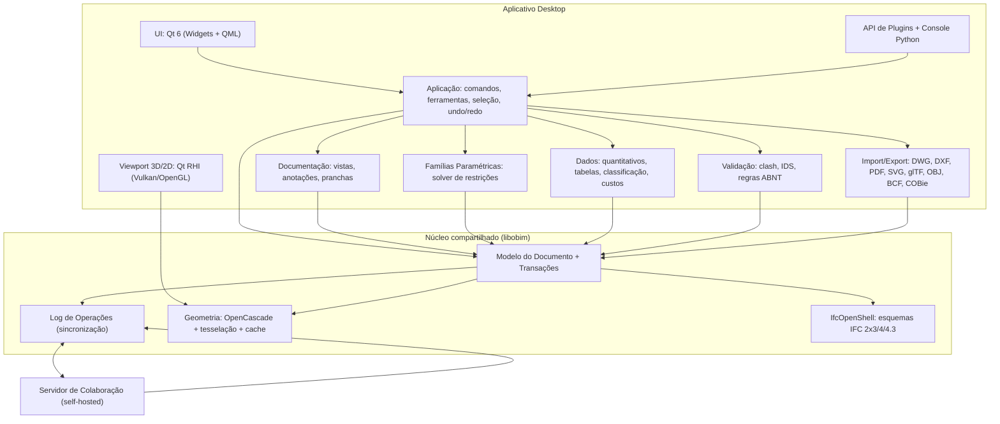
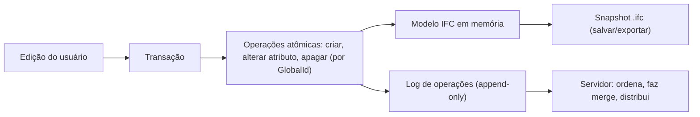
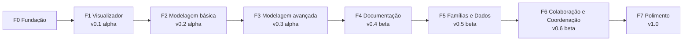
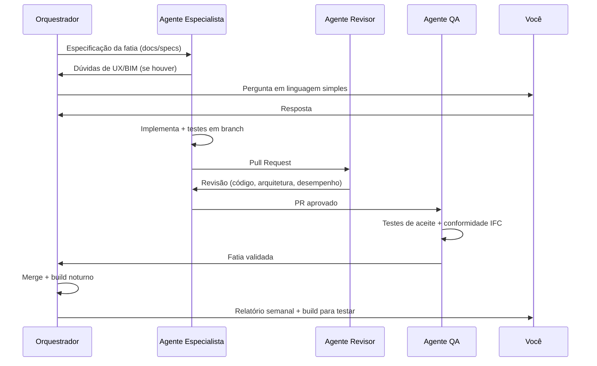

# OpenBIM Studio: Plano Mestre de Desenvolvimento

> Nome provisório. Este documento é o **contrato** entre você (Product Owner e especialista BIM) e a equipe de agentes de IA. Nenhum código será escrito até que você o aprove.

---

## 1. Visão

Um software BIM **completo, nativo para Linux, 100% open source, offline-first e sem telemetria**. Ele permite fazer um projeto arquitetônico do estudo preliminar ao executivo, com coordenação multidisciplinar, usando **IFC como formato nativo**, e não só como formato de exportação.

### Princípios inegociáveis
1. **Seus dados são seus.** Sem conta obrigatória, sem nuvem obrigatória, sem telemetria. O servidor de colaboração é *self-hosted*.
2. **IFC é a verdade.** O modelo da edificação é sempre um IFC válido. Nada fica preso em formato proprietário.
3. **Sempre utilizável.** Cada fase termina com uma versão que você instala e usa de verdade.
4. **Fluxo de trabalho de arquiteto.** A interface segue o que Revit e ArchiCAD fazem bem (níveis, vistas, tipos, pranchas), sem copiar o que eles fazem mal.
5. **Brasil primeiro.** ABNT, SINAPI e pt-BR desde o início, com arquitetura pronta para outros países.
6. **Qualidade verificável sem ler código.** Tudo é provado por testes automáticos e por roteiros de aceite que você executa.

---

## 2. Decisões já tomadas

| # | Tema | Decisão |
|---|------|---------|
| D1 | Base técnica | App desktop próprio sobre **IfcOpenShell** (IFC) e **OpenCascade** (geometria) |
| D2 | Licença | Copyleft forte (GPL v3 / AGPL v3) |
| D3 | Escopo v1.0 | Modelagem arquitetônica, documentação 2D, pranchas, quantitativos, **famílias paramétricas** e **clash detection** |
| D4 | Normas | Brasil primeiro (ABNT, SINAPI/TCPO, pt-BR), localização modular |
| D5 | Colaboração | Local e offline-first **mais servidor multiusuário em tempo real self-hosted na v1.0** |
| D6 | Agentes | Orquestrador, especialistas, QA e revisão cruzada |
| D7 | Formatos | IFC 4.3/4/2x3 nativo, DWG/DXF, PDF, SVG, OBJ/glTF, BCF, COBie. Sem .rvt/.pln |

## 3. Premissas adotadas (até você responder às perguntas abertas)

| # | Premissa | Pode mudar? |
|---|----------|-------------|
| P1 | Licença **AGPL v3**, porque também protege o servidor contra uso como serviço fechado | Sim, na Fase 0 |
| P2 | Nome provisório "OpenBIM Studio" | Sim, a qualquer momento antes da 1.0 |
| P3 | Hardware de referência mínimo: CPU de 4 núcleos, 16 GB de RAM, GPU com OpenGL 4.5 ou Vulkan 1.2 (inclusive integrada recente) | Sim |
| P4 | Distribuições-alvo: Ubuntu LTS, Fedora, Arch, Debian. Windows e macOS são "bônus" (o código é multiplataforma, mas sem testes formais antes da 1.0) | Sim |
| P5 | Nenhuma IA embutida no produto na v1.0 (mas arquitetura de plugins permite IA local depois) | Sim |

---

## 4. Arquitetura

### 4.1 Visão em camadas



### 4.2 Stack tecnológica proposta (confirmada por protótipos na Fase 0)

| Camada | Tecnologia | Por quê | Licença |
|--------|-----------|---------|---------|
| Núcleo | **C++20** | Desempenho; IfcOpenShell e OpenCascade são C++ | (nossa) AGPL |
| IFC | **IfcOpenShell 0.8+** | O motor IFC open source mais maduro, com suporte a IFC 4.3 | LGPL 3 |
| Geometria | **OpenCascade (OCCT) 7.8+** | Sólidos B-Rep, booleanas, linhas ocultas (HLR) para cortes | LGPL 2.1 + exceção |
| Restrições (famílias) | **SolveSpace libslvs** (alternativa: PlaneGCS do FreeCAD) | Solver geométrico 2D/3D comprovado | GPL 3 / LGPL |
| Clash | **IfcClash** (IfcOpenShell) e BVH próprio | Já entende IFC, rápido | LGPL 3 |
| Interface | **Qt 6.7+** | Maduro, nativo em Linux, ótimo para apps técnicos (FreeCAD, KiCad, QGIS) | LGPL 3 |
| Scripting/Plugins | **Python 3.12** via nanobind | Linguagem que a comunidade BIM já usa (Bonsai, ifcopenshell-python) | — |
| DWG | **LibreDWG** | Única lib DWG livre | GPL 3 |
| PDF/SVG | Qt PDF Writer / Cairo | Vetorial e com espessuras de linha corretas | LGPL |
| Servidor | **C++20 reaproveitando libobim**, com WebSocket (Boost.Beast) e SQLite/PostgreSQL | Cliente e servidor usam **o mesmo código de merge**, o que elimina divergências | AGPL |
| Build | CMake + vcpkg/Conan, CI no GitHub/Forgejo Actions | Padrão da indústria | — |
| Pacotes | **Flatpak** (principal), AppImage, .deb, AUR, Docker (servidor) | Cobre todas as distros | — |

> [!NOTE]
> Todas as dependências são compatíveis com AGPL v3. A Fase 0 inclui uma auditoria automatizada de licenças no CI.

### 4.3 Modelo de dados (a decisão mais importante do projeto)



- **Toda edição vira uma sequência de operações** sobre entidades IFC identificadas por `GlobalId`, com relógio lógico híbrido (HLC).
- Isso serve ao mesmo tempo para **undo/redo**, **histórico de versões**, **autosave/recuperação de travamento** e **colaboração em tempo real**.
- Por isso o log de operações existe **desde a Fase 2**, mesmo que o servidor só chegue na Fase 6.

**Formato de projeto (`.obim`)**: um contêiner ZIP aberto e documentado contendo:

| Arquivo | Conteúdo |
|---------|----------|
| `model.ifc` | Modelo da edificação, IFC 4.3 válido, abre em qualquer software |
| `oplog/` | Histórico de operações |
| `views.json` | Vistas, templates de vista, sobreposições gráficas |
| `sheets.json` | Pranchas, carimbos, viewports, revisões |
| `families/` | Definições paramétricas das famílias (a geometria gerada também fica no IFC como `IfcTypeProduct`) |
| `settings.json` | Configurações do projeto, unidades, normas |

> [!IMPORTANT]
> O IFC não tem conceito de "prancha" nem de "família paramétrica". Esses dados ficam ao lado do IFC, em arquivos abertos, mas **o IFC sozinho continua completo e válido** para qualquer outro software.

### 4.4 Estrutura do repositório

```
openbim-studio/
├── docs/              # manual do usuário, ADRs, especificações
│   ├── adr/           # registros de decisão de arquitetura
│   ├── specs/         # especificação de cada fatia
│   └── user/          # manual pt-BR
├── core/              # libobim: modelo, transações, oplog, geometria
├── app/               # aplicativo desktop (UI, ferramentas, viewport)
├── modules/
│   ├── documentation/ # vistas, anotações, pranchas
│   ├── families/      # editor e solver de famílias
│   ├── data/          # quantitativos, classificação, custos
│   ├── validation/    # clash, IDS, regras
│   └── io/            # DWG, DXF, PDF, SVG, glTF, BCF, COBie
├── server/            # servidor de colaboração
├── plugins/           # API pública + plugins de exemplo
├── locale/            # pacotes de localização (pt-BR, en, ...)
│   └── br/            # ABNT: carimbos, hachuras, layers, SINAPI, NBR 15965
├── content/           # bibliotecas: famílias, materiais, templates
├── tests/
│   ├── corpus/        # IFCs de referência (buildingSMART e projetos reais)
│   ├── conformance/   # testes de conformidade IFC
│   ├── visual/        # regressão visual de vistas e pranchas
│   ├── perf/          # benchmarks
│   └── acceptance/    # roteiros de aceite automatizados
└── packaging/         # Flatpak, AppImage, deb, AUR, Docker
```

---

## 5. Estratégia de entrega: fatias verticais

### 5.1 O que é uma fatia
Uma **fatia vertical** é uma capacidade **completa e utilizável de ponta a ponta**: interface, lógica, núcleo, IFC, testes e documentação. Exemplo: "criar uma parede com camadas" inclui a ferramenta na interface, a geometria, a gravação em IFC como `IfcWall` com `IfcMaterialLayerSetUsage`, o undo, o teste e a página do manual.

Fatias **não** são "fazer a camada de banco de dados inteira primeiro". Cada fatia entrega valor visível.

### 5.2 Hierarquia de entregas

| Nível | O que é | Exemplo | Tamanho típico |
|-------|---------|---------|----------------|
| **Fase** | Marco com versão instalável e "portão" de aceite | F2: Modelagem básica | Várias semanas |
| **Fatia** | Capacidade de ponta a ponta | F2-S04: Paredes com camadas | 3 a 10 dias de agente |
| **Tarefa** | Unidade técnica dentro da fatia | Join de paredes em L | Horas a 2 dias |

### 5.3 Definição de Pronto (DoD) de toda fatia
- [ ] Especificação da fatia em `docs/specs/` aprovada pelo orquestrador (e por você quando houver impacto na UX)
- [ ] Funciona na interface, sem precisar de console
- [ ] Undo/redo funciona (a partir da F2)
- [ ] O IFC gerado passa no **validador oficial da buildingSMART** e abre corretamente em pelo menos 2 softwares externos (Bonsai, FreeCAD, BIMvision ou similar)
- [ ] Testes unitários e de integração, com cobertura de no mínimo 80% do código novo
- [ ] Teste de aceite automatizado reproduzindo o roteiro do usuário
- [ ] Sem regressão de desempenho acima de 5% nos benchmarks
- [ ] Revisado por um agente diferente do autor
- [ ] Textos traduzidos (pt-BR e en)
- [ ] Página no manual do usuário com captura de tela
- [ ] Entrada no CHANGELOG

### 5.4 Portão de fase (Phase Gate)
Ao fim de cada fase:
1. **Build instalável** (Flatpak e AppImage) publicado.
2. **Relatório em pt-BR** do orquestrador: o que foi feito, o que ficou de fora, riscos, métricas.
3. **Roteiro de aceite** executado por você (de 30 min a 2 h). Você marca ✅/❌ em cada item.
4. Os itens reprovados viram fatias de correção **antes** da próxima fase começar.
5. Você aprova formalmente a passagem de fase.

### 5.5 Sequência de versões



> [!NOTE]
> A partir da F4, algumas fatias de F5 e F6 podem rodar **em paralelo** (por exemplo, o servidor de colaboração pode começar enquanto a documentação está sendo feita), desde que as dependências da seção 6 sejam respeitadas. O orquestrador decide o paralelismo.

---

## 6. Fases e fatias

Legenda de tamanho: **P** = pequena (até 3 dias), **M** = média (3 a 7 dias), **G** = grande (7 a 15 dias de agente). As estimativas de calendário serão calibradas ao fim da F0.

---

### FASE 0: Fundação
**Objetivo:** reduzir os grandes riscos técnicos **antes** de escrever o produto. Nenhuma funcionalidade para o usuário final, exceto uma janela que abre um IFC.

| ID | Fatia | Entrega | Tam. |
|----|-------|---------|------|
| F0-S01 | Repositório e governança | Repo, licença AGPL, CONTRIBUTING, código de conduta, template de issues/PR, estrutura de pastas | P |
| F0-S02 | CI/CD | Build Linux (GCC e Clang), testes, lint, sanitizers, auditoria de licenças, geração de Flatpak/AppImage a cada merge | M |
| F0-S03 | ADRs de arquitetura | Decisões documentadas: stack, modelo de dados, formato `.obim`, threading, API de plugins | M |
| F0-S04 | **Protótipo: log de operações sobre IFC** | Prova de que é possível editar um IFC por operações, desfazer, e fazer merge de duas edições concorrentes sem corromper o arquivo | G |
| F0-S05 | **Protótipo: viewport** | Renderizar um IFC de 100 MB a ≥30 FPS no hardware de referência | M |
| F0-S06 | **Protótipo: corte e planta (HLR)** | Gerar planta e corte vetoriais com linhas ocultas a partir de um IFC, em menos de 5 s | M |
| F0-S07 | **Protótipo: solver de famílias** | Uma janela paramétrica (largura, altura, peitoril) resolvida por restrições e gravada como `IfcWindowType` | M |
| F0-S08 | Corpus de testes | Coleta de IFCs de referência (buildingSMART, exemplos públicos, seus projetos) com resultados esperados | P |
| F0-S09 | **Design de UX com você** | Wireframes das telas principais (janela principal, navegador de projeto, propriedades, editor de vistas, pranchas). Você revisa e aprova | M |
| F0-S10 | App esqueleto | Janela Qt que abre um IFC e mostra o 3D, empacotada em Flatpak | P |

**Portão F0:** os 4 protótipos (S04 a S07) atingem as metas. Se algum falhar, o plano é revisto **antes** de seguir. Você aprova os wireframes.

---

### FASE 1: Visualizador IFC (v0.1 alpha)
**Objetivo:** substituir visualizadores como BIMvision e Solibri Anywhere no Linux. Primeira versão que você usa de verdade.

| ID | Fatia | O que você vai poder fazer | Critério de aceite | Tam. |
|----|-------|---------------------------|-------------------|------|
| F1-S01 | Abrir IFC | Abrir arquivos IFC 2x3, 4 e 4.3 (`.ifc`, `.ifczip`, `.ifcxml`) com barra de progresso | 100% do corpus abre sem erro; 100 MB em menos de 30 s | M |
| F1-S02 | Navegação 3D | Orbitar, pan e zoom (com presets estilo Revit, ArchiCAD e Blender), ViewCube, zoom extents, navegação em primeira pessoa | 60 FPS com 1 M de triângulos | M |
| F1-S03 | Árvore espacial | Ver Projeto › Terreno › Edifício › Pavimento › Espaço › Elemento e filtrar por classe IFC | Seleção sincronizada entre árvore e 3D | M |
| F1-S04 | Painel de propriedades | Ver atributos, Psets, Qtos, materiais, tipo e classificação do elemento selecionado | Mostra 100% dos Psets do corpus | M |
| F1-S05 | Visibilidade | Ocultar, isolar, mostrar tudo, transparência, cor por propriedade | Funciona em seleção múltipla | P |
| F1-S06 | Caixa de corte e planos de corte | Caixa de corte 3D e planos arbitrários | Em tempo real, sem travar | M |
| F1-S07 | Medição | Medir distância, ângulo, área e coordenadas com snaps a vértice, aresta e face | Precisão de 0,1 mm | M |
| F1-S08 | Salvar sem perdas (round-trip) | Salvar o IFC aberto sem alterar nada que não foi editado | O diff semântico do corpus é zero | M |
| F1-S09 | Exportar glTF/OBJ | Exportar para visualização e renderização (Blender, Twinmotion etc.) | Abre no Blender com materiais | P |
| F1-S10 | Configurações básicas | Idioma, unidades, tema claro/escuro, atalhos personalizáveis | Persistem entre sessões | P |

**Portão F1 (roteiro):** abrir 3 IFCs exportados do Revit/ArchiCAD, navegar, inspecionar propriedades, cortar, medir, salvar e reabrir em outro software.

---

### FASE 2: Núcleo de edição e modelagem básica (v0.2 alpha)
**Objetivo:** modelar uma edificação simples de um pavimento e exportar um IFC válido.

| ID | Fatia | O que você vai poder fazer | Critério de aceite | Tam. |
|----|-------|---------------------------|-------------------|------|
| F2-S01 | Transações, undo/redo e autosave | Desfazer e refazer ilimitado; recuperação após travamento | Matar o processo e reabrir recupera tudo até 30 s antes | G |
| F2-S02 | Novo projeto e template | Criar projeto a partir de um template BR (unidades em m/cm, pavimentos padrão, materiais) | Gera IFC 4.3 com hierarquia espacial correta | M |
| F2-S03 | Níveis e grids | Criar, editar e renomear níveis (`IfcBuildingStorey`) e eixos (`IfcGrid`) | Elementos acompanham a mudança de cota do nível | M |
| F2-S04 | **Paredes** | Paredes retas e curvas, por linha ou por cadeia, com tipos de camadas (`IfcMaterialLayerSet`), linha de localização (eixo, face, núcleo), altura por nível superior e deslocamentos | Joins em L, T e X limpos e camadas unidas por prioridade | G |
| F2-S05 | Lajes e pisos | Laje por contorno ou por paredes, com camadas, inclinação e furos | `IfcSlab` com `IfcMaterialLayerSetUsage` | M |
| F2-S06 | Pilares e vigas | Pilares e vigas por perfil (`IfcProfileDef`), com biblioteca de perfis (retangular, circular, I, H) | Perfis paramétricos editáveis | M |
| F2-S07 | Aberturas, portas e janelas (tipos fixos) | Inserir portas e janelas hospedadas em paredes (`IfcOpeningElement` + `IfcRelFillsElement`), com espelhamento e lado de abertura | A parede recorta automaticamente; mover a porta move o vão | G |
| F2-S08 | Snaps, planos de trabalho e cotas temporárias | Snaps (extremidade, meio, interseção, perpendicular, paralelo, tangente, grid), entrada numérica, cotas temporárias editáveis estilo Revit | Desenhar com precisão sem usar o mouse para medir | G |
| F2-S09 | Edição geral | Mover, copiar, rotacionar, espelhar, matriz linear/polar, alinhar, aparar/estender, dividir, alças de edição | Todas com undo e IFC atualizado | G |
| F2-S10 | Sistema de tipos | Navegador de tipos (`IfcTypeObject`): duplicar, editar e trocar o tipo de instâncias | Editar o tipo atualiza todas as instâncias | M |
| F2-S11 | Edição de propriedades | Editar atributos, Psets padrão e Psets personalizados, inclusive em massa | IFC exportado reflete as mudanças | M |
| F2-S12 | Materiais | Biblioteca de materiais com cor, textura, hachura de corte e de superfície, e propriedades físicas | Materiais exportados em IFC com estilos | M |
| F2-S13 | Formato `.obim` | Salvar e abrir o contêiner de projeto completo | Abrir, salvar e reabrir é idêntico | M |

**Portão F2 (roteiro):** modelar uma casa térrea de cerca de 60 m² com paredes de alvenaria rebocada, laje, pilares, 4 portas e 6 janelas. Exportar o IFC, validar no validador buildingSMART e abrir no Revit/ArchiCAD de um colega ou no Bonsai.

---

### FASE 3: Modelagem avançada (v0.3 alpha)
**Objetivo:** modelar uma edificação residencial multipavimento completa.

| ID | Fatia | Entrega | Tam. |
|----|-------|---------|------|
| F3-S01 | Telhados | Telhado por contorno com inclinação por aresta (águas), por extrusão e plano; beirais; recorte de paredes pelo telhado | G |
| F3-S02 | Escadas | Escadas retas, em L, em U e helicoidais, por componente ou esboço, com verificação de Blondel e da NBR 9050 | G |
| F3-S03 | Guarda-corpos e corrimãos | Por caminho ou hospedados em escadas, rampas e lajes | M |
| F3-S04 | Rampas | Com verificação de inclinação conforme a NBR 9050 | M |
| F3-S05 | Fachadas cortina | Grade, painéis, montantes e painéis de porta ou janela (`IfcCurtainWall`) | G |
| F3-S06 | Forros | Forro por ambiente ou contorno (`IfcCovering`) | P |
| F3-S07 | Revestimentos e acabamentos | Revestimento de piso e parede por ambiente (`IfcCovering`), paginação básica | M |
| F3-S08 | **Ambientes (espaços)** | `IfcSpace` automático por fechamento, nome, número, área (útil, construída, conforme a NBR 12721), perímetro, pé-direito, volume | G |
| F3-S09 | Zonas | Agrupar ambientes (`IfcZone`): unidades, setores, zonas de incêndio | P |
| F3-S10 | Terreno e topografia | `IfcSite` com georreferenciamento (`IfcMapConversion`, SIRGAS 2000/UTM), superfície por pontos, curvas de nível ou importação de CSV/DXF, platôs, corte e aterro básicos | G |
| F3-S11 | Componentes de biblioteca | Inserir mobiliário, louças e equipamentos de uma biblioteca inicial (tipos fixos até a F5) | M |
| F3-S12 | Modelagem livre | Massas, extrusão, revolução, varredura, booleanas e "objetos genéricos" com classe IFC atribuível | G |
| F3-S13 | Fases de obra | Existente, a demolir e a construir (status IFC + filtros de fase) | M |
| F3-S14 | Grupos e montagens | Grupos repetíveis (`IfcGroup`/`IfcElementAssembly`), com edição de grupo propagada | M |
| F3-S15 | Opções de projeto | Alternativas de projeto (como as Design Options do Revit) dentro do mesmo modelo | M |
| F3-S16 | Desempenho com modelos grandes | Carregamento incremental, LOD na viewport, regeneração paralela | G |

**Portão F3 (roteiro):** modelar um sobrado de 2 pavimentos com telhado em 4 águas, escada em U, guarda-corpo, ambientes com áreas calculadas e terreno com desnível.

---

### FASE 4: Documentação (v0.4 beta)
**Objetivo:** produzir **pranchas de projeto legal e executivo dentro das normas ABNT**, imprimíveis e exportáveis.

| ID | Fatia | Entrega | Tam. |
|----|-------|---------|------|
| F4-S01 | Sistema de vistas | Plantas, plantas de forro, cortes, elevações, vistas 3D (perspectiva/axonométrica), vistas de detalhe (callout) e vistas de desenho 2D. Navegador de projeto | G |
| F4-S02 | Motor de desenho 2D | Geração vetorial com linhas ocultas, cortadas e de projeção; atualização incremental ao editar o modelo | G |
| F4-S03 | Gráficos por categoria | Espessuras, tipos de linha, cores e hachuras por classe IFC, material e estado (cortado/vista). Padrão **NBR 16861 / NBR 6492** | G |
| F4-S04 | Templates de vista e sobreposições | Templates (planta baixa, layout, forro, cobertura, executivo), filtros por regra, nível de detalhe (grosso, médio, fino) e escala | M |
| F4-S05 | Cotas | Lineares, alinhadas, angulares, radiais, de cadeia, de nível (cota de piso) e de coordenada. **Associativas** ao modelo | G |
| F4-S06 | Textos e tags | Textos, chamadas, tags de elementos, tags de ambiente (nome, área, piso), marcadores de nível e de eixo, símbolos de corte e elevação, norte | G |
| F4-S07 | Desenho 2D | Linhas, arcos, polilinhas, hachuras, regiões mascaradas, componentes de detalhe 2D e isolamento térmico | M |
| F4-S08 | **Pranchas e carimbo ABNT** | Formatos A0–A4 (NBR 16752), carimbo editável com campos automáticos, viewports com escala, lista de desenhos | G |
| F4-S09 | Revisões | Nuvens de revisão, tabela de revisões no carimbo e controle de emissões | M |
| F4-S10 | Exportar PDF | PDF vetorial multipágina com espessuras corretas e camadas opcionais | M |
| F4-S11 | Exportar e importar DWG/DXF | Exportar com mapeamento de layers (padrão AsBEA/ABNT configurável) e importar DWG como referência ou base | G |
| F4-S12 | Exportar SVG/PNG | Para portfólio e apresentações | P |
| F4-S13 | Impressão | Impressão direta (CUPS) com configuração de plotter | P |
| F4-S14 | Vistas de apresentação | Estilos gráficos (sombras, contorno, cor de material, desenho à mão), vistas renderizadas simples | M |
| F4-S15 | Regressão visual | Testes comparando pixel a pixel as pranchas de referência | M |

**Portão F4 (roteiro):** gerar o **projeto legal completo** do sobrado da F3 (situação, implantação, plantas, cobertura, 2 cortes, 4 fachadas, quadro de áreas), imprimir em PDF A1 e exportar DWG que abre no LibreCAD ou no AutoCAD de um colega.

---

### FASE 5: Famílias paramétricas e dados (v0.5 beta)
**Objetivo:** criar conteúdo próprio, extrair quantitativos e orçar.

| ID | Fatia | Entrega | Tam. |
|----|-------|---------|------|
| F5-S01 | **Editor de famílias: esboço e restrições** | Ambiente de edição com planos de referência, esboço 2D, restrições (paralelo, perpendicular, igual, coincidente, cota travada) | G |
| F5-S02 | Editor de famílias: sólidos | Extrusão, revolução, varredura, mistura e vazios, presos aos planos de referência | G |
| F5-S03 | Parâmetros e fórmulas | Parâmetros de tipo e de instância, fórmulas, condicionais, tabelas de tipos (catálogo) | G |
| F5-S04 | Visibilidade por vista e nível de detalhe | Simbologia 2D própria em planta (por exemplo, arco da porta), visibilidade por nível de detalhe | M |
| F5-S05 | Famílias hospedadas e aninhadas | Hospedeiro (parede, laje, forro, face), famílias dentro de famílias, parâmetros associados | G |
| F5-S06 | Exportação IFC das famílias | Geração de `IfcTypeProduct` + `RepresentationMaps` + Psets; propriedades IFC mapeáveis | M |
| F5-S07 | **Biblioteca inicial BR** | Cerca de 150 famílias: portas, janelas (padrões brasileiros), louças, metais, mobiliário, equipamentos, esquadrias de alumínio, blocos cerâmicos/concreto | G |
| F5-S08 | Tabelas e quantitativos | Tabelas de elementos, materiais e ambientes, com filtros, agrupamentos, campos calculados e totais; colocáveis em pranchas | G |
| F5-S09 | Quantidades IFC | Geração automática de `Qto_*` (áreas, volumes, comprimentos) conforme o padrão buildingSMART | M |
| F5-S10 | Classificação | **NBR 15965**, Uniclass e OmniClass (`IfcClassificationReference`) | M |
| F5-S11 | Orçamento SINAPI/TCPO | Importar tabelas SINAPI por estado e mês, vincular composições a elementos e tipos, gerar orçamento sintético | G |
| F5-S12 | Exportar planilhas | CSV, ODS e XLSX | P |
| F5-S13 | COBie | Exportar COBie (planilha e IFC) | M |
| F5-S14 | IDS | Carregar especificações IDS (Information Delivery Specification) e validar o modelo com relatório | M |
| F5-S15 | Regras ABNT | Verificações automáticas: NBR 9050 (vãos, rampas, sanitários acessíveis), NBR 15575 (pé-direito mínimo), áreas mínimas configuráveis por código de obras municipal | G |

**Portão F5 (roteiro):** criar uma família de janela de correr parametrizada com catálogo de tamanhos, usá-la no sobrado, gerar um quadro de esquadrias numa prancha, classificar com a NBR 15965 e gerar orçamento SINAPI de alvenaria e revestimentos.

---

### FASE 6: Colaboração e coordenação (v0.6 beta)
**Objetivo:** equipes trabalhando juntas no mesmo modelo e coordenando disciplinas.

| ID | Fatia | Entrega | Tam. |
|----|-------|---------|------|
| F6-S01 | Servidor self-hosted | Servidor em binário único ou Docker, administração web mínima, contas locais, HTTPS, backups | G |
| F6-S02 | Projetos no servidor | Publicar um projeto local no servidor, clonar, permissões (dono, editor, leitor) | M |
| F6-S03 | **Sincronização em tempo real** | Edições aparecem para os outros em menos de 1 s na rede local | G |
| F6-S04 | Presença | Ver quem está online, onde está e o que está selecionando | M |
| F6-S05 | Reserva de elementos | Reserva automática ao editar, solicitar e emprestar (como os worksets do Revit e o Teamwork do ArchiCAD) | G |
| F6-S06 | Conflitos e modo offline | Trabalhar offline, sincronizar depois e resolver conflitos com interface visual | G |
| F6-S07 | Histórico e versões | Linha do tempo, marcos nomeados, voltar a uma versão, comparar versões (diff visual) | G |
| F6-S08 | Modelos vinculados (federação) | Vincular IFCs de estrutura e instalações como referência, com posicionamento compartilhado e recarga | M |
| F6-S09 | **Clash detection** | Conjuntos por filtro, tolerância, clash duro e por folga, agrupamento, status, relatório | G |
| F6-S10 | BCF | Criar, importar e exportar BCF 2.1/3.0, vincular issues a vistas e elementos, BCF API no servidor | G |
| F6-S11 | Comparação de modelos | Diferenças entre duas versões de IFC (adicionado, removido, alterado) | M |
| F6-S12 | Segurança | Auditoria do servidor, criptografia em trânsito, logs de acesso, testes de carga (10 usuários simultâneos) | M |

**Portão F6 (roteiro):** você e um colega (ou duas máquinas suas) editam o sobrado ao mesmo tempo. Um vincula um IFC estrutural, roda o clash, gera issues BCF e o outro as resolve.

---

### FASE 7: Polimento e versão 1.0
**Objetivo:** um produto estável, rápido, documentado e fácil de instalar.

| ID | Fatia | Entrega | Tam. |
|----|-------|---------|------|
| F7-S01 | Campanha de desempenho | Perfilamento e otimização de todos os fluxos para atingir as metas da seção 8 | G |
| F7-S02 | Campanha de estabilidade | Fuzzing do importador IFC, testes de longa duração (8 h de uso simulado), zero travamentos conhecidos | G |
| F7-S03 | Polimento de UX | Revisão de todos os fluxos com você: consistência, atalhos, mensagens de erro claras, tooltips | G |
| F7-S04 | Acessibilidade | Navegação por teclado, escala de interface (HiDPI), temas de alto contraste | M |
| F7-S05 | Primeiros passos | Tela de boas-vindas, projeto de exemplo, tutorial interativo | M |
| F7-S06 | Manual e tutoriais | Manual completo em pt-BR e en, 10 tutoriais em vídeo/texto ("do zero ao projeto legal") | G |
| F7-S07 | API de plugins 1.0 estável | API Python documentada e versionada, console Python, 5 plugins de exemplo | M |
| F7-S08 | Templates de projeto | Residencial unifamiliar, multifamiliar, comercial, todos com padrão ABNT | M |
| F7-S09 | Empacotamento final | Flathub, AppImage, .deb/.rpm, AUR, Docker do servidor; builds Windows e macOS experimentais | M |
| F7-S10 | Site e comunidade | Site, fórum/Matrix, guia de contribuição, roadmap público | M |
| F7-S11 | Release Candidate | 2 ciclos de RC com testes de usuários reais (colegas de faculdade) | M |

**Portão 1.0 (roteiro final):** fazer **um projeto real seu, completo**, do estudo à prancha executiva, com um colega colaborando, sem travamentos e sem precisar de outro software.

---

### Depois da 1.0 (roadmap)
| Versão | Tema |
|--------|------|
| 1.x | Scripting visual (estilo Dynamo/Grasshopper) |
| 1.x | Renderização realista integrada (Cycles/LuxCore) e exportação para Blender |
| 2.0 | Estrutura: armaduras, modelo analítico, ligação com OpenSees/Code_Aster |
| 2.0 | MEP: hidráulica, elétrica, HVAC, com dimensionamento conforme normas BR |
| 2.x | 4D (cronograma) e 5D (custos no tempo) |
| 2.x | GIS e infraestrutura (IFC 4.3: estradas, pontes, ferrovias) |
| 2.x | Análises energética e de insolação (EnergyPlus, Radiance) |
| 2.x | Assistente de IA local opcional |
| 2.x | Pacotes de localização: Portugal, EUA, UE |

---

## 7. Trilhas transversais (rodam em todas as fases)

| Trilha | Responsável | Atividade contínua |
|--------|-------------|--------------------|
| Conformidade IFC | Agente Núcleo IFC + QA | Validar todo IFC gerado contra o esquema 4.3 e o validador buildingSMART |
| Desempenho | Agente Arquiteto | Benchmarks a cada merge; alerta de regressão |
| Localização | Agente Normas BR | Tradução pt-BR/en, conteúdo ABNT |
| Documentação | Agente Documentação | Manual atualizado a cada fatia |
| Segurança | Agente DevOps | Dependências atualizadas, varredura de vulnerabilidades |
| UX | Agente UI/UX + você | Consistência visual, revisão sua a cada fase |

---

## 8. Metas de desempenho (hardware de referência)

| Operação | Meta |
|----------|------|
| Abrir IFC de 100 MB | < 30 s |
| Abrir IFC de 500 MB | < 2 min, sem estourar 8 GB de RAM |
| Viewport com 1 M de triângulos | ≥ 60 FPS |
| Viewport com 10 M de triângulos | ≥ 30 FPS (com LOD) |
| Criar ou editar uma parede (com joins) | < 100 ms |
| Regenerar uma planta após uma edição | < 500 ms |
| Gerar uma prancha A1 completa | < 5 s |
| Exportar PDF de 20 pranchas | < 60 s |
| Salvar projeto | < 5 s (incremental) |
| Latência de sincronização (rede local) | < 1 s |
| Clash detection entre 50 mil elementos | < 60 s |
| Inicialização do aplicativo | < 3 s |

---

## 9. Equipe de agentes e processo

> [!IMPORTANT]
> **Plataforma de execução: Claude Code (assinatura Claude).** A configuração completa está em [claude_code_setup.md](file:///home/rafael/.gemini/antigravity/brain/6ba73e4f-349c-472d-b653-b3f5b9e09639/claude_code_setup.md). Resumo:
> - **Orquestrador = sessão principal com `haiku`.** Só roteia por regras fixas; não escreve código.
> - **Execução com modelos baratos:** `haiku` para tarefas T0/T1, `sonnet` para T2/T3.
> - **Julgamento com modelo avançado:** `opus` escreve especificações e ADRs, revisa T2/T3 e corrige bloqueadores críticos.
> - **Escalonamento automático:** 2 falhas do Haiku → Sonnet; 2 falhas do Sonnet → Opus; falha do Opus → PO.
> - Nova fatia **F0-S00** configura subagentes, hooks, comandos e estado em disco antes de tudo.
>
> Os papéis abaixo são implementados como subagentes do Claude Code (`.claude/agents/`).

### 9.1 Papéis

| Agente | Responsabilidade | Fases de maior atuação |
|--------|------------------|------------------------|
| **Orquestrador** | Mantém o plano, cria e prioriza fatias, distribui tarefas, integra, relata a você | Todas |
| **Arquiteto de Software** | ADRs, contratos entre módulos, desempenho, revisão técnica final | F0 e todas |
| **Núcleo IFC** | Modelo, transações, oplog, IfcOpenShell, conformidade | F0–F2, F6 |
| **Geometria** | OpenCascade, booleanas, joins, tesselação, HLR | F0–F4 |
| **UI/UX** | Interface Qt, viewport, ferramentas, interação | Todas |
| **Modelagem** | Ferramentas de elementos (parede, laje, telhado, escada...) | F2–F3 |
| **Documentação 2D** | Vistas, anotações, pranchas, PDF/DWG | F4 |
| **Famílias** | Solver, editor de famílias, biblioteca | F0, F5 |
| **Dados e Normas BR** | Quantitativos, SINAPI, NBR 15965, regras ABNT, localização | F3–F5 |
| **Colaboração** | Protocolo de sincronização, servidor, BCF | F0, F6 |
| **QA** | Testes, corpus, regressão visual, aceite automatizado, fuzzing | Todas |
| **DevOps** | CI/CD, empacotamento, releases, segurança | Todas |
| **Documentação/Comunidade** | Manual, tutoriais, site | Todas |

### 9.2 Fluxo de cada fatia



### 9.3 Regras
1. **Nenhum merge sem CI verde, revisão de outro agente e aprovação do QA.**
2. **Branches curtas:** uma branch por fatia, merge em até 2 semanas.
3. **Feature flags:** funcionalidades incompletas ficam escondidas na build estável.
4. **Builds:** *nightly* (todo dia), *alpha/beta* (fim de fase).
5. **Escalonamento para você:** qualquer decisão de fluxo de trabalho, interface ou interpretação de norma. Decisões puramente técnicas ficam com o Arquiteto.
6. **Relatório semanal em pt-BR:** o que foi feito, o que vem, bloqueios, decisões pendentes, métricas (testes, desempenho, bugs).
7. **Registro de decisões:** toda decisão relevante vira um ADR em `docs/adr/`.

### 9.4 Seu papel (Product Owner)
- Aprovar especificações de UX (wireframes) antes de cada fase.
- Responder a dúvidas de BIM e normas (em média 1 a 3 por semana).
- Executar o roteiro de aceite ao fim de cada fase.
- Testar builds nightly quando quiser e reportar problemas em linguagem natural (o orquestrador transforma em issue).
- Fornecer projetos reais para o corpus de testes.

---

## 10. Estratégia de qualidade

| Nível | O que testa | Quando roda |
|-------|-------------|-------------|
| Unitário | Funções isoladas (geometria, solver, parsing) | Cada commit |
| Integração | Módulos juntos (editar → IFC → recarregar) | Cada PR |
| Conformidade IFC | Esquema, regras de implementação, validador buildingSMART, round-trip | Cada PR |
| Regressão visual | Vistas e pranchas versus imagens de referência | Cada PR (a partir da F4) |
| Desempenho | Benchmarks da seção 8 | Cada merge, com alerta se piorar mais de 5% |
| Aceite | Roteiros de usuário automatizados (UI testing) | Nightly |
| Interoperabilidade | Abrir os IFCs gerados em Bonsai, FreeCAD e xeokit | Nightly |
| Fuzzing | Arquivos IFC corrompidos ou malformados | Nightly (a partir da F1) |
| Carga | Servidor com múltiplos clientes | Nightly (a partir da F6) |

---

## 11. Riscos e mitigações

| # | Risco | Prob. | Impacto | Mitigação |
|---|-------|-------|---------|-----------|
| R1 | Colaboração em tempo real sobre IFC ser inviável ou instável | Média | Alto | Protótipo na F0 (S04); oplog desde a F2; plano B: colaboração por reserva de elementos e sincronização periódica (estilo Teamwork) |
| R2 | Escopo grande demais | Alta | Alto | Fatias pequenas, portões de fase, corte por prioridade (MoSCoW) em cada fase |
| R3 | Qualidade da geometria (joins de parede, booleanas) | Alta | Alto | Agente dedicado, corpus de casos difíceis, testes visuais |
| R4 | Desempenho em modelos grandes | Média | Alto | Benchmarks desde a F0; LOD; cache de geometria; carregamento incremental |
| R5 | Solver de famílias instável | Média | Médio | Protótipo na F0; alternativa PlaneGCS |
| R6 | DWG (LibreDWG imatura em algumas versões) | Média | Médio | DXF como garantia; testes com arquivos reais |
| R7 | Código de IA com bugs sutis | Alta | Alto | Revisão cruzada, cobertura de testes, sanitizers, fuzzing |
| R8 | Mudanças nas dependências (IfcOpenShell e OCCT) | Média | Médio | Versões fixadas; atualização controlada |
| R9 | Você sem tempo para validar | Média | Médio | Roteiros curtos e objetivos; aceite automatizado cobre o básico |
| R10 | Sustentabilidade após a 1.0 | Média | Alto | Documentação de contribuição, comunidade, governança aberta |

---

## 12. Perguntas abertas

> [!IMPORTANT]
> Estas respostas ajustam as premissas da seção 3. Nenhuma bloqueia a aprovação do plano, mas **Q1 e Q4 precisam de resposta antes da Fase 0 começar**.

1. **Licença:** confirma **AGPL v3** (recomendado) ou prefere GPL v3?
2. **Nome do projeto:** tem alguma ideia?
3. **Seu hardware e sua distribuição Linux:** ajusta o hardware de referência (P3).
4. **Ferramentas de agentes:** quais você tem ou assina (Antigravity, Claude Code, Codex, Gemini CLI...)? Define quantos agentes podem rodar em paralelo.
5. **Projetos reais:** pode fornecer IFCs e pranchas de projetos seus (ou de exemplo) para o corpus de testes?
6. **Onde hospedar o código:** GitHub (mais visibilidade), Codeberg/Forgejo (mais alinhado com a filosofia livre) ou ambos (espelho)?
7. **Interface:** prefere que a lógica de interface se pareça mais com o **Revit** (abas, propriedades, navegador de projeto) ou com o **ArchiCAD** (caixa de ferramentas, navegador, pens)? Ou um híbrido?
8. **Windows/macOS:** builds experimentais antes da 1.0 são desejáveis ou pode ser "só Linux" até lá?
9. **Plano da assinatura Claude:** Pro, Max 5x ou Max 20x? Isso define o paralelismo e a frequência de revisões Opus (recomendado: Max).

> ✅ **Q4 respondida:** Claude Code via assinatura Claude, com hierarquia de modelos Haiku/Sonnet/Opus.

---

## 13. Próximo passo após aprovação

1. Você responde às perguntas Q1 e Q4 (no mínimo).
2. Eu preparo o **briefing do Orquestrador**: um documento autocontido com este plano, as regras do processo e a especificação detalhada das fatias da Fase 0.
3. O Orquestrador inicia a **Fase 0**, e você recebe o primeiro relatório semanal.
