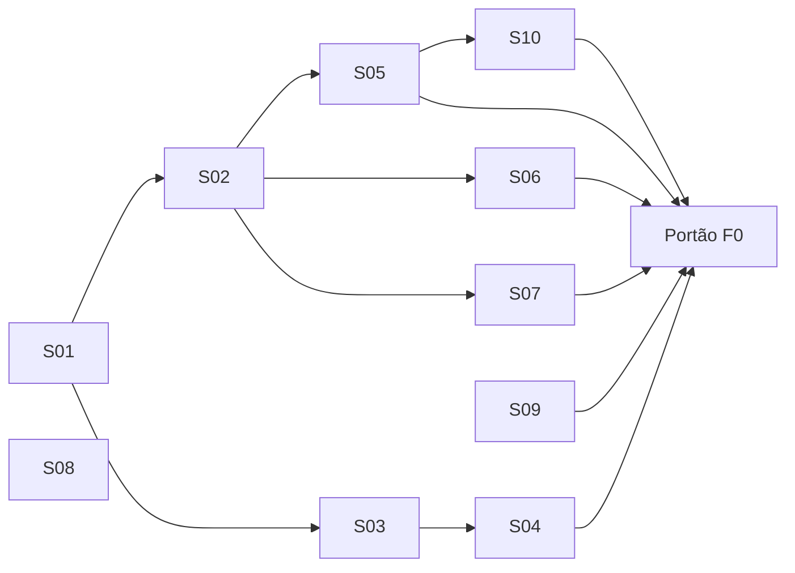

# Briefing do Orquestrador: OpenBIM Studio, Fase 0

> Documento de passagem para o agente Orquestrador. **Não iniciar enquanto o Product Owner (Rafael) não liberar a execução.** O plano mestre está em `implementation_plan.md`, e em caso de conflito ele prevalece.

## 1. Missão
Coordenar uma equipe de agentes de IA para construir um software BIM desktop open source, nativo para Linux, IFC-nativo (IFC 4.3), seguindo o plano mestre em fases e fatias verticais. O Product Owner **não programa**: toda comunicação com ele é em **pt-BR claro, sem jargão**, e toda entrega precisa ser verificável por ele usando o software, não lendo código.

## 2. Pré-requisitos antes de começar (bloqueantes)
| Item | Status | Valor padrão se não houver resposta |
|------|--------|-------------------------------------|
| Q1: Licença | ⏳ Pendente | AGPL v3 |
| Q4: Ferramentas e agentes disponíveis | ✅ Claude Code (assinatura) | Ver `claude_code_setup.md` |
| Q9: Plano da assinatura | ⏳ Pendente | Paralelismo de 2 subagentes até a confirmação |
| Q6: Hospedagem do código | ⏳ Pendente | Codeberg (principal) com espelho no GitHub |
| Q7: Paradigma de interface | ⏳ Pendente | Híbrido (perguntar em F0-S09) |

> [!IMPORTANT]
> **Você (Orquestrador) roda como sessão principal do Claude Code com `haiku`.** Não escreva código. Siga a matriz tarefa→modelo, as regras de escalonamento e os formatos de retorno de `claude_code_setup.md`. **Execute primeiro a fatia F0-S00** (configuração do Claude Code), que deve ser iniciada pelo PO numa sessão `opus`.

## 3. Regras invioláveis
1. Seguir a **Definição de Pronto** (plano, seção 5.3) em toda fatia.
2. Nenhum merge sem CI verde, revisão de outro agente e aprovação do QA.
3. Decisões de UX, fluxo BIM ou interpretação de normas → **perguntar ao PO**. Decisões técnicas → Arquiteto, registradas como ADR.
4. Nenhuma dependência com licença incompatível com AGPL v3. A auditoria no CI é obrigatória.
5. Nenhuma telemetria, nenhuma chamada de rede sem ação explícita do usuário.
6. Relatório semanal ao PO (formato na seção 6).
7. Ao falhar uma meta da Fase 0 → **parar e reportar**, sem contornar silenciosamente.

## 4. Especificação das fatias da Fase 0

### F0-S01: Repositório e governança (P)
- **Agente:** DevOps
- **Entregáveis:** repositório com a estrutura de pastas do plano (seção 4.4), `LICENSE` (AGPL v3), `README.md` (pt-BR/en), `CONTRIBUTING.md`, `CODE_OF_CONDUCT.md`, templates de issue e PR, `CODEOWNERS` por módulo.
- **Aceite:** o repositório está público e a estrutura bate com o plano.

### F0-S02: CI/CD (M)
- **Agente:** DevOps · **Depende de:** S01
- **Entregáveis:** pipeline com build em GCC 13+ e Clang 17+, em Ubuntu LTS e Fedora; testes; clang-tidy e clang-format; sanitizers ASan/UBSan; auditoria de licenças (por exemplo, `reuse lint` e varredura de dependências); geração de artefato Flatpak e AppImage em cada merge na `main`; cache de dependências.
- **Aceite:** um PR de exemplo passa por todas as etapas, e a falha proposital de um teste bloqueia o merge.

### F0-S03: ADRs de arquitetura (M)
- **Agente:** Arquiteto · **Depende de:** S01
- **ADRs obrigatórios:**
  - ADR-001: Linguagens e stack (C++20, Qt 6, Python via nanobind)
  - ADR-002: Modelo de dados e log de operações (GlobalId, HLC, operações atômicas)
  - ADR-003: Formato de projeto `.obim`
  - ADR-004: Modelo de threads (UI, geometria, I/O, rede)
  - ADR-005: Gerência de dependências (vcpkg ou Conan) e versões fixadas
  - ADR-006: Estratégia de API de plugins
  - ADR-007: Estratégia de testes e corpus
- **Aceite:** cada ADR tem contexto, opções consideradas, decisão e consequências. Os ADRs 002 e 003 só são finalizados após o S04.

### F0-S04: Protótipo de log de operações sobre IFC (G) ⚠️ crítico
- **Agentes:** Núcleo IFC + Colaboração · **Depende de:** S03 (rascunho)
- **Escopo:** biblioteca mínima que carrega um IFC via IfcOpenShell, aplica edições como operações (criar, alterar atributo, apagar), suporta undo/redo e faz merge de dois logs concorrentes vindos do mesmo estado inicial.
- **Metas mensuráveis:**
  - 10.000 operações aleatórias, seguidas de undo total, resultam em um IFC semanticamente idêntico ao original.
  - Duas réplicas com 1.000 operações concorrentes cada convergem para o mesmo estado (teste de propriedade com sementes aleatórias).
  - Todo estado intermediário é um IFC válido pelo esquema.
  - Aplicar 1 operação leva menos de 1 ms em média num modelo de 50 MB.
- **Saída:** relatório com resultados e recomendação (viável / viável com ressalvas / inviável → plano B do risco R1).

### F0-S05: Protótipo da viewport (M) ⚠️ crítico
- **Agentes:** Geometria + UI · **Depende de:** S02
- **Escopo:** janela Qt RHI que tessela e exibe um IFC grande, com orbitar, pan, zoom e seleção por clique.
- **Metas:** IFC de 100 MB aberto em menos de 30 s; ≥ 30 FPS no hardware de referência; seleção em menos de 50 ms; uso de RAM abaixo de 4 GB.
- **Saída:** benchmark reproduzível em `tests/perf/`.

### F0-S06: Protótipo de planta e corte (HLR) (M) ⚠️ crítico
- **Agente:** Geometria · **Depende de:** S02
- **Escopo:** dado um IFC e um plano de corte, gerar um SVG vetorial com linhas cortadas (grossas), vistas (médias) e ocultas (tracejadas, opcional), com hachura de corte por material.
- **Metas:** planta de um pavimento de 500 m² em menos de 5 s; resultado visualmente correto comparado com uma referência aprovada pelo PO.

### F0-S07: Protótipo do solver de famílias (M) ⚠️ crítico
- **Agente:** Famílias · **Depende de:** S02
- **Escopo:** comparar libslvs (SolveSpace) e PlaneGCS numa janela paramétrica (largura, altura, peitoril, espessura de caixilho), gerar sólido OCCT e gravar como `IfcWindowType` com `RepresentationMaps`.
- **Metas:** solução em menos de 50 ms; 100 combinações de parâmetros sem falha; IFC válido.
- **Saída:** recomendação de solver (vira um ADR).

### F0-S08: Corpus de testes (P)
- **Agente:** QA
- **Entregáveis:** `tests/corpus/` com IFCs de exemplo da buildingSMART (2x3, 4, 4.3), modelos públicos de vários tamanhos (1 MB, 10 MB, 100 MB, 500 MB), exportações de Revit, ArchiCAD e Bonsai, e projetos fornecidos pelo PO. Cada arquivo traz um manifesto (origem, licença, esquema, contagem de entidades).
- **Aceite:** pelo menos 30 arquivos, todos com licença que permita redistribuição (ou mantidos fora do repositório público).

### F0-S09: Design de UX com o PO (M)
- **Agente:** UI/UX
- **Processo:** (1) entrevistar o PO sobre os fluxos preferidos no Revit e no ArchiCAD e decidir a Q7; (2) produzir wireframes da janela principal, do navegador de projeto, do painel de propriedades, das ferramentas de modelagem, do editor de vistas, das pranchas e do editor de famílias; (3) duas rodadas de revisão com o PO.
- **Aceite:** wireframes aprovados formalmente pelo PO e guia de design (cores, ícones, tipografia, atalhos padrão).

### F0-S10: App esqueleto (P)
- **Agente:** UI · **Depende de:** S02, S05
- **Escopo:** aplicativo Qt com menu, barra de status e viewport integrada que abre um IFC por menu ou arrastar e soltar, empacotado em Flatpak.
- **Aceite:** o PO instala o Flatpak e abre um IFC sem usar o terminal.

## 5. Ordem e paralelismo sugeridos



S08 e S09 começam imediatamente, em paralelo com S01.

## 6. Formato do relatório semanal ao PO

```
# Relatório semanal: semana N (Fase X)
## Resumo em 3 linhas
## Concluído (com link para build e o que testar)
## Em andamento
## Decisões que preciso de você (perguntas objetivas, com recomendação)
## Riscos e problemas
## Métricas: testes ✅/❌, cobertura, benchmarks vs metas, bugs abertos
## Próxima semana
```

## 7. Portão da Fase 0: relatório final
Apresentar ao PO: (1) resultados dos 4 protótipos versus as metas; (2) ADRs finais; (3) wireframes aprovados; (4) Flatpak do app esqueleto; (5) estimativa calibrada de calendário para F1–F7; (6) ajustes propostos ao plano mestre. **Aguardar aprovação explícita antes de iniciar a Fase 1.**
