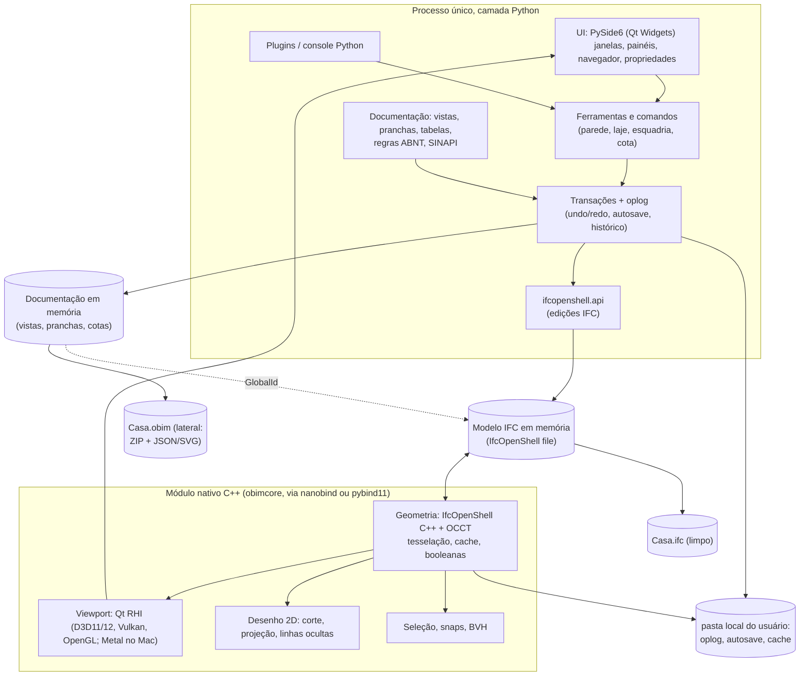

# 02. Plano mestre v2: OpenBIM Studio

> Substitui `implementation_plan.md` quando aprovado pelo PO. O original permanece como histórico. Itens **[verificar F0]** são hipóteses que só um teste prático responde; **[verificado em 2026-10-10]** remete a `07_verificacoes_web.md`.
> **Revisão 2 (decisões do PO):** corte da 1.0 aprovado; AGPL v3 confirmada; plano Claude Pro; Windows+Linux testados pelo PO, macOS "melhor esforço" até pós-1.0; **vistas, pranchas, carimbos, viewports e revisões em arquivo lateral `.obim` ao lado de um IFC limpo** (§6); corpus do PO entra depois da F0.
> Correção de item menor: o link do plano original para `claude_code_setup.md` apontava para `~/.gemini/...`; nesta v2 todos os links são relativos à pasta do projeto (ex.: `../claude_code_setup.md`, superado por `04_processo_agentes_v2.md`).

## 1. Visão
Programa BIM **dedicado, aberto (AGPL v3) e multiplataforma (Windows e Linux na 1.0; macOS em seguida)**, com **IFC como arquivo nativo**, que permite a um arquiteto fazer **projeto legal e executivo residencial** sem outro software. O núcleo é geral (sem país); a 1.0 entrega o **pacote regional Brasil** (pranchas ABNT, quadro de áreas legal, SINAPI). Outros países entram depois como pacotes regionais.

## 2. Princípios (revistos)
1. **Seus dados são seus.** Sem conta, sem nuvem, sem telemetria.
2. **IFC é a verdade do modelo; o IFC fica limpo.** Edificação, tipos, materiais, ambientes e quantidades ficam no `.ifc`, válido e sem anotações de prancha. Documentação (vistas, pranchas, carimbos, viewports, revisões, cotas e tags) fica num arquivo lateral aberto `.obim`, que referencia o IFC por GlobalId. Histórico e cache são descartáveis.
3. **Sempre utilizável no Windows e no Linux.** Cada fase termina com instaladores Windows/Linux testados pelo PO; macOS recebe build de CI "melhor esforço".
4. **Fluxo de arquiteto.** Nível, vista, tipo, prancha.
5. **Núcleo geral, Brasil como primeiro pacote regional.** Todo texto traduzível; regras e conteúdo em pacotes regionais.
6. **Verificável pelo uso.** O PO aceita por roteiro, vídeo e instalador, nunca por leitura de código.
7. **Escopo é a variável de ajuste.** Prazo e qualidade se mantêm; corta-se recurso.
8. **Fontes públicas apenas.** Sem engenharia reversa (ver `05`).

## 3. Decisões (v2)
| # | Tema | Decisão v2 | Mudou? |
|---|---|---|---|
| D1 | Stack | **Híbrido**: C++ (viewport, geometria, tesselação, HLR: OCCT + IfcOpenShell C++) e Python (PySide6/Qt 6, ifcopenshell.api, regras, plugins). Validado na F0 contra C++ puro | sim |
| D2 | Licença | AGPL v3, com auditoria de dependências na F0 | confirmada |
| D3 | Escopo 1.0 | **Residencial, legal + executivo ABNT** (ver MoSCoW) | **sim, reduzido** |
| D4 | Normas | Núcleo sem país; Brasil é o primeiro pacote regional; regras parametrizadas, sem reproduzir texto protegido | refinada |
| D5 | Colaboração | 1.0: individual + troca de IFC/BCF. 2.0: reserva de elementos + sincronização periódica. Tempo real: pesquisa pós-2.0 | **sim** |
| D6 | Agentes | 3 papéis iniciais, crescimento sob gatilho (ver `04`) | **sim** |
| D7 | Formatos | IFC 4 (ADD2 TC1) como padrão de gravação, IFC 2x3 leitura+exportação, IFC 4.3 leitura; PDF, DXF (garantia), SVG, glTF; DWG só como bônus; BCF leitura/escrita; COBie 2.0 | **sim** |
| D8 | Plataformas | Windows 10/11 x64 e Ubuntu LTS/Fedora (x64): CI obrigatório desde a F0 e teste manual do PO. macOS (Apple Silicon): build de CI "melhor esforço", sem teste manual; portão formal de Mac só pós-1.0 ou quando houver tester | **sim (Rev. 2)** |
| D9 | Projeto | **`Casa.ifc` (limpo) + `Casa.obim` (lateral: ZIP com JSON/SVG de documentação)**, lado a lado; histórico/autosave na pasta local do usuário; pacote opcional `.obimpack` para envio (ver §6) | **sim (Rev. 2)** |
| D10 | Rust | Opcional e cirúrgico; só se a F0-S04 mostrar necessidade (oplog/merge ou servidor 2.0) | novo |

### 3.1 Por que IFC 4 e não 4.3 como gravação padrão
IFC 4.3 é ISO (16739-1:2024) mas o ganho dele é infraestrutura. Verificação: o Revit 2024/2025 já exporta 4.3 (com ressalvas por ferramenta), mas a documentação da Graphisoft (2025/2026) afirma que **IFC2x3 CV 2.0 ainda é o padrão certificado mundialmente** e o add-in de importação ArchiCAD→Revit só lê 2x3 **[verificado em 2026-10-10; `07` §2]**. Gravamos IFC4 por padrão, oferecemos 4.3 como opção e **a exportação IFC2x3 vira critério de portão** (F2 e F5), porque é o formato que o colega com Revit/ArchiCAD mais aceita. Revisar na 2.0.

## 4. Resposta às críticas do plano original
| # | Crítica | Veredito | Tratamento |
|---|---|---|---|
| 1 | Falta análise competitiva | **Aceita** | `01_analise_competitiva_e_posicionamento.md` |
| 2 | Escopo 1.0 de equipe enorme; estimativas otimistas | **Aceita** | Corte para residencial legal+executivo; MVP v0.3 "Planta Legal"; estimativas em faixas e calibradas na F0; fatias medidas em "sessões" e não em dias |
| 3 | Tempo real sobre IFC é arriscado | **Aceita** | Plano A = reserva + sincronização (2.0). Oplog fica para undo/autosave/histórico. A F0 ainda testa merge, mas em escala reduzida e como insumo para 2.0 |
| 4 | Vistas/pranchas no IFC | **Resolvida pelo PO (Rev. 2): Opção 2** | IFC limpo + arquivo lateral `.obim` (§6). A pesquisa mostrou que nem o Bonsai guarda tudo no IFC: a posição do desenho na prancha fica no SVG e o estilo em CSS **[verificado em 2026-10-10; `07` §1]** |
| 5 | Direito autoral ABNT | **Aceita** | Política de conteúdo em `05` |
| 6 | DWG fraco | **Aceita** | DXF garantido com ezdxf (MIT) **[verificado em 2026-10-10]**; DWG via conversor externo opcional; LibreDWG (GPL-3.0-or-later, compatível) como bônus; libdxfrw só após ler o LICENSE (licença disputada, possível GPLv2-only, incompatível) |
| 7 | Processo pesado; oráculos | **Aceita** | `04`: 3 papéis, sem hooks antes de produto; seção 10 deste documento para oráculos |
| 8 | Multiplataforma real | **Aceita** | Seção 12 e F0-S02 (Windows+Linux obrigatórios; macOS melhor esforço) |
| 9 | Metas de desempenho irreais | **Parcialmente aceita** | Algumas eram razoáveis; revisadas e separadas em "portão" vs "acompanhamento" (seção 9) |
| 10 | Itens menores | **Aceita** | Link corrigido; perguntas abertas resolvidas com padrões em `06` |

**Refutação parcial à crítica 2:** a proposta de deixar "tipos paramétricos" inteiramente para 2.0 é forte demais. Sem esquadrias com tamanho variável não existe executivo residencial (quadro de esquadrias). Mantemos na 1.0 **tipos paramétricos por script/perfil** (parâmetros + gerador de geometria em Python, sem editor gráfico de restrições).

## 5. Arquitetura híbrida

**Pontos críticos a provar na F0:**
- A mesma instância de `ifcopenshell.file` precisa ser compartilhada entre Python (ifcopenshell-python, que já é um wrapper do C++) e o módulo C++ sem cópia. Isso exige compilar nosso módulo contra **a mesma versão/ABI do IfcOpenShell** que o Python usa (ou compilar IfcOpenShell e o wrapper juntos). É o maior risco técnico da arquitetura **[verificar F0: só um protótipo responde; não é verificável na web]**.
- O loop de renderização não pode depender do GIL do Python: viewport e tesselação rodam em threads C++.
- pythonocc é útil para prototipar, mas **não** deve ser a ponte de produção se o objeto OCCT precisar cruzar Python↔C++ (duas cópias de OCCT = risco de ABI). Decisão na F0-S04/S05.

## 6. Modelo de dados (Revisão 2: IFC limpo + arquivo lateral)

> Decisão do PO (pergunta 5, Opção 2): vistas, pranchas, carimbos, viewports e revisões ficam **fora** do IFC, num arquivo lateral aberto. O IFC permanece limpo e válido, sem `IfcAnnotation` de prancha. Esta seção é a especificação de partida; o formato exato é fechado no ADR-003 (F0-S06).

### 6.1 Onde fica cada coisa
| Dado | Onde | Como |
|---|---|---|
| Edificação, tipos, materiais, ambientes (IfcSpace), níveis, eixos (IfcGrid), quantidades | `Casa.ifc` | Entidades IFC padrão, Qto_* buildingSMART |
| Tipo paramétrico (gerador) | `Casa.ifc` | `IfcTypeProduct` + pset `OBIM_Parametric` (gerador, versão, parâmetros); geometria resultante sempre gravada |
| Vínculo com o lateral | `Casa.ifc` | Um único pset `OBIM_Projeto` no `IfcProject` com `LadoId` (UUID) e `Revisao` (inteiro). É IFC válido, invisível em outros programas, e pode sumir sem dano (há verificação por hash) |
| Vista (planta, corte, fachada, situação, cobertura) | `Casa.obim` | `views/<id>.json`: tipo, plano de corte/câmera, faixa de vista, escala, template, sobreposições por elemento (GlobalId) |
| Template de vista e gráfico por categoria | `Casa.obim` | `styles/*.json` (espessuras, hachuras por material, cortado/vista) |
| Prancha, carimbo, viewports | `Casa.obim` | `sheets/<id>.json` (formato, viewports com posição/escala/vista), `titleblocks/*.svg` + campos |
| Revisões | `Casa.obim` | `revisions.json` (número, data, descrição, pranchas afetadas) |
| Cotas, textos, tags, símbolos 2D | `Casa.obim` | dentro da vista; âncoras por GlobalId + referência geométrica (ver §6.3) |
| Logos, fontes de carimbo | `Casa.obim` | `assets/` |
| Histórico/oplog, autosave | pasta local do usuário (`…/OpenBIMStudio/projetos/<LadoId>/`) | Não viaja com o projeto; apagar não perde nada além do histórico |
| Cache de geometria e de desenhos | pasta local do usuário | Descartável |
| Preferências | pasta do usuário | Fora do projeto |

### 6.2 Formato do arquivo lateral `.obim`
**O `.obim` volta, mas com outro papel:** não é contêiner do IFC (o IFC nunca vai dentro dele no uso normal). É o "caderno de documentação" do projeto, sempre ao lado do IFC com o mesmo nome-base: `Casa.ifc` + `Casa.obim`.

- **ZIP com JSON (e SVG para carimbos)**, não pasta. Por quê: (1) um arquivo só é mais difícil de quebrar ao copiar, mandar por e-mail ou sincronizar em Drive/OneDrive (pastas chegam incompletas); (2) o arquiteto vê dois arquivos com o mesmo nome, fácil de entender; (3) ZIP é aberto: qualquer descompactador mostra JSON legível; (4) para versionamento em git, há comando "exportar lateral como pasta" (desenvolvedores), não é o padrão.
- `manifest.json` obrigatório: `formato: "obim-lateral"`, `versao_formato` (semver; migrações automáticas para versões antigas, nunca apagando campos desconhecidos), `LadoId`, `Revisao`, `ifc_nome`, `ifc_sha256` e `ifc_tamanho` do IFC gravado junto, `ifc_projeto_globalid` (GlobalId do `IfcProject`), `programa_versao`, data.
- Esquema JSON publicado no repositório (licença aberta) para que outros programas possam ler.
- Exportação opcional futura (Could/2.0): "exportar vistas como IfcAnnotation no estilo Bonsai" num IFC separado, para quem quiser vistas em outro programa. O IFC principal nunca recebe isso.

### 6.3 Referência a elementos por GlobalId
- Toda referência do lateral ao modelo usa **GlobalId** (nunca id de linha STEP, que muda a cada gravação).
- Nosso programa **nunca muda GlobalId** de elemento existente (ifcopenshell preserva). Dividir/juntar paredes gera novos GlobalIds e o comando atualiza as referências na mesma transação.
- Cotas e tags guardam: GlobalId do elemento + **âncora geométrica** (ex.: "face de acabamento externa da camada 1", "eixo") + última posição conhecida em coordenadas da vista. Se a âncora não puder ser resolvida, a cota mantém a posição e fica marcada.
- **Quando GlobalIds somem ou mudam** (IFC editado em outro programa; o Revit, por exemplo, pode gerar GlobalIds novos ao reimportar, relato não oficial em `07` §2):
  1. Ao abrir, o programa resolve todas as referências e mostra um **painel "Referências quebradas"** com contagem por vista/prancha.
  2. Oferece **reassociação assistida**: candidato com mesma classe IFC + Name/Tag + caixa envolvente próxima (tolerância configurável); o usuário confirma em lote ("aceitar todas as sugestões com confiança alta").
  3. O que não for reassociado fica **órfão visível** (cota cinza tracejada), nunca apagado em silêncio.

### 6.4 Detecção de separação ou divergência
| Situação ao abrir `Casa.ifc` | Detecção | O que o usuário vê |
|---|---|---|
| Lateral presente e casando | `ifc_sha256` igual | Nada; abre normal |
| IFC alterado fora do programa | hash diferente, `LadoId` e `ifc_projeto_globalid` iguais | Aviso: "O modelo foi alterado em outro programa depois da última gravação. A documentação foi verificada: N referências quebradas." Abre o painel |
| Lateral de versão mais nova que o IFC (ex.: IFC antigo restaurado) | `Revisao` do lateral > `Revisao` do pset no IFC | Aviso: "A documentação é mais nova que o modelo." Opções: abrir assim, procurar outro IFC |
| Lateral ausente | não existe `Casa.obim` | "Documentação não encontrada." Opções: localizar arquivo, abrir só o modelo (cria lateral novo vazio ao gravar) |
| Lateral de outro projeto | `ifc_projeto_globalid` diferente | Recusa vincular automaticamente; pergunta |
| Abrir `Casa.obim` direto | lê `ifc_nome` | Procura o IFC ao lado; se não achar, pede para localizar |

### 6.5 Gravar, autosave, histórico, mover e enviar
- **Gravar** é atômico para o par: grava `Casa.ifc.tmp` e `Casa.obim.tmp`, calcula o hash do IFC, escreve o manifesto, depois renomeia os dois (IFC primeiro). Um diário na pasta local registra "gravação em andamento"; se o programa cair no meio, a reabertura detecta e conclui ou desfaz.
- **Oplog único:** uma transação pode conter operações no IFC (via ifcopenshell, que já tem transações próprias) e no lateral (operações JSON). Desfazer volta as duas juntas. É o mesmo padrão do Bonsai, que mantém uma transação para o IFC e outra para dados fora do IFC **[verificado em 2026-10-10; `07` §1]**.
- **Autosave** grava o par em `…/projetos/<LadoId>/autosave/`, nunca por cima dos arquivos do usuário.
- **Salvar como / mover:** "Salvar como" sempre grava os dois com o novo nome. Mover pelo gerenciador de arquivos funciona desde que os dois fiquem juntos com o mesmo nome-base; se não, a tabela do §6.4 trata.
- **Enviar a colega:**
  - Colega com o OpenBIM Studio: **Arquivo > Exportar pacote** gera `Casa.obimpack` (ZIP com `Casa.ifc` + `Casa.obim` + manifesto). Abrir um pacote pergunta onde extrair e abre o par. Recomendado para e-mail/WhatsApp.
  - Colega com Revit/ArchiCAD/Bonsai: envia só `Casa.ifc` (limpo e válido) e as pranchas em PDF/DXF.
- **Para o arquiteto, a regra é uma frase:** "o projeto são dois arquivos com o mesmo nome; para mandar, use Exportar pacote".

### 6.6 Riscos da Opção 2
| Risco | Mitigação |
|---|---|
| Usuário manda só o IFC e perde a documentação | Exportar pacote em destaque; aviso ao fechar se o par está em pasta de nuvem sem o `.obim` sincronizado; IFC sozinho continua útil |
| IFC editado fora e GlobalIds trocados | §6.3 (reassociação assistida, órfãos visíveis) |
| Conflito de sincronização (Drive/Dropbox) gera cópias "conflitantes" de um dos dois | Detecção por hash/Revisao; oferecer escolher o par coerente |
| Formato lateral evoluir e quebrar arquivos antigos | `versao_formato`, migrações testadas no CI com arquivos de cada versão |
| Outros programas não veem nossas vistas | Aceito por decisão do PO; exportação Bonsai opcional futura |
| Dois arquivos confundem o usuário | Ícone próprio do `.obim`; abrir qualquer um dos dois abre o projeto |

### 6.7 Oplog (escopo reduzido)
- Toda edição passa por uma **transação** que registra operações (criar/alterar/apagar por GlobalId, ou por id estável do lateral).
- Usos na 1.0: desfazer/refazer, autosave/recuperação, histórico local ("voltar para ontem").
- Preparação para 2.0: operações identificadas por elemento permitem **reserva por elemento** e **merge periódico**. Não implementamos HLC/CRDT na 1.0. Na 2.0, o lateral é JSON por objeto (uma vista, uma prancha), o que facilita mesclar.

## 7. Fases e fatias

Tamanhos em **sessões de agente** (uma sessão ≈ meio dia útil de trabalho de agente supervisionado, incluindo testes e correções): **P** ≤ 3, **M** 4–8, **G** 9–20. Cada fase tem um portão com roteiro do PO.

### F0. Provas técnicas (detalhada em `03`)
Saída: decisão go/no-go do stack, ADRs, CI Windows+Linux obrigatório (macOS melhor esforço), app esqueleto instalável no Windows e no Linux, corpus público, medição de cota.

### F1. Visualizador IFC multiplataforma (v0.1)
| ID | Fatia | Aceite verificável pelo PO | Tam. |
|---|---|---|---|
| F1-S01 | Abrir IFC 2x3/4/4.3 com progresso | 95% do corpus público abre; quando o PO entregar seus projetos, eles abrem e "parecem certos" (lado a lado com captura do Revit/ArchiCAD) | M |
| F1-S02 | Navegação 3D (presets Revit/ArchiCAD), ViewCube, zoom extents | Roteiro de 10 passos; FPS exibido na barra de status | M |
| F1-S03 | Árvore espacial e filtro por classe | Clicar na árvore seleciona no 3D e vice-versa | M |
| F1-S04 | Propriedades (atributos, psets, qtos, material, tipo) | Mesmos valores que BIMvision/Bonsai em 10 elementos sorteados | M |
| F1-S05 | Visibilidade: ocultar/isolar/transparência/cor por propriedade | Roteiro | P |
| F1-S06 | Planos e caixa de corte | Roteiro | M |
| F1-S07 | Medição com snaps | Medidas batem com cotas conhecidas do corpus (±1 mm); projetos do PO quando disponíveis | M |
| F1-S08 | Salvar sem perdas | Diff semântico zero no corpus (ferramenta: ifcdiff/IfcOpenShell) | M |
| F1-S09 | Instaladores Windows/Linux (DMG de CI para Mac, sem teste manual) | PO instala no Windows e no Linux sem terminal | M |
**Portão F1:** roteiro de 30 min no Windows e no Linux com 3 IFCs (do PO, se já entregues; senão, públicos).

### F2. Modelagem básica (v0.2)
| ID | Fatia | Aceite | Tam. |
|---|---|---|---|
| F2-S01 | Transações, undo/redo, autosave | Matar o processo e reabrir recupera até 30 s antes | G |
| F2-S02 | Novo projeto a partir do template BR | Gera par `Casa.ifc` (válido) + `Casa.obim` com pavimentos, materiais e vistas padrão | M |
| F2-S03 | Níveis e eixos | Mudar cota do nível move elementos dependentes | M |
| F2-S04 | Paredes retas com camadas, linha de localização, joins L/T | 20 casos de join do "caderno de joins" do PO renderizam igual à referência visual | G |
| F2-S05 | Lajes por contorno, com furos | Roteiro + IFC válido | M |
| F2-S06 | Pilares e vigas por perfil | Roteiro | M |
| F2-S07 | Portas e janelas hospedadas (tipos fixos) com vão | Mover porta move o vão; IFC com IfcOpeningElement/IfcRelFillsElement | G |
| F2-S08 | Snaps, entrada numérica, cotas temporárias | Desenhar casa de 60 m² sem medir com mouse | G |
| F2-S09 | Edição: mover, copiar, rotacionar, espelhar, alinhar, aparar | Roteiro | G |
| F2-S10 | Navegador de tipos e edição de propriedades | Editar o tipo atualiza instâncias | M |
**Portão F2:** casa térrea 60 m² modelada em ≤ 2 h pelo PO; IFC4 passa no validador buildingSMART; exportação IFC2x3 abre no Revit/ArchiCAD de um colega ou no Bonsai.

### F3. Documentação essencial (v0.3 "Planta Legal", primeiro MVP de uso real)
| ID | Fatia | Aceite | Tam. |
|---|---|---|---|
| F3-S01 | Ambientes (IfcSpace) por fechamento, área, perímetro, pé-direito | Áreas batem com cálculo manual do PO (±0,01 m²) | G |
| F3-S02 | Vistas (no `.obim`): planta e corte gerados do modelo (HLR) | Planta/corte comparados lado a lado com prancha de referência do PO (ou referência pública aprovada por ele) | G |
| F3-S03 | Gráfico por categoria (espessura, hachura por material, cortado/vista) e template BR | PO aprova visualmente em 3 escalas (1:50, 1:100, 1:200) | G |
| F3-S04 | Cotas associativas lineares e de nível; tags de ambiente | Mover parede atualiza cota | G |
| F3-S05 | Pranchas A0–A4 com carimbo configurável e viewports (no `.obim`); Exportar pacote `.obimpack` | Prancha montada em ≤ 15 min; pacote enviado e reaberto em outra máquina igual | G |
| F3-S06 | Exportar PDF vetorial | PDF imprime em A1 com espessuras corretas (régua na impressão) | M |
| F3-S07 | Quadro de áreas | Tabela na prancha igual ao cálculo manual | M |
**Portão v0.3:** PO produz planta baixa, 1 corte, situação simples e quadro de áreas de uma casa térrea, em PDF, num dia de trabalho.

### F4. Modelagem residencial completa (v0.5)
Coberturas (águas por aresta, recorte de paredes), escadas retas/L/U, guarda-corpos, forros, revestimentos por ambiente, terreno simples (pontos/curvas, platô), componentes de biblioteca (tipos fixos), **tipos paramétricos por script** (esquadrias de correr, portas, com parâmetros largura/altura/peitoril), fases simples (existente/demolir/construir: necessário para reforma no legal brasileiro).
**Portão:** sobrado 2 pavimentos com cobertura 4 águas e escada em U.

### F5. Documentação executiva e dados (v0.8)
Fachadas e elevações, cortes múltiplos, planta de cobertura, detalhes (callout + desenho 2D), textos/tags/símbolos, revisões, painel de referências quebradas e reassociação (§6.3), tabelas (esquadrias, materiais, ambientes) em prancha, Qto_* automáticos, classificação (estrutura de códigos configurável; ver `05` sobre NBR 15965), vínculo SINAPI básico (importar planilha baixada pelo usuário, sem redistribuir; associar composição a tipo, quantitativo × preço), exportar DXF com mapa de layers configurável, CSV/XLSX, BCF importar/exportar, IDS (validar modelo contra arquivo IDS).
**Portão:** projeto legal completo + 5 pranchas executivas do sobrado; DXF abre no LibreCAD/AutoCAD; IFC2x3 exportado abre no Revit/ArchiCAD de um colega.

### F6. Estabilização e 1.0
Desempenho, estabilidade (fuzzing do importador), UX com o PO, manual pt-BR, projeto exemplo, tutoriais em vídeo, API de plugins Python estável, assinatura de código no instalador Windows (SignPath para OSS, se aprovado), 2 RCs com 5 a 10 arquitetos reais.
**Portão 1.0:** um projeto real do PO, do estudo ao executivo, sem outro software e sem travamento em 8 h de uso.

## 8. MoSCoW da 1.0
| Must (1.0 não sai sem) | Should (entra se o calendário permitir) | Could | Won't (2.0+) |
|---|---|---|---|
| Visualizador Windows/Linux; paredes/lajes/pilares/vigas/esquadrias/cobertura/escada simples; ambientes e áreas; planta, corte, fachada, cobertura, situação; cotas e tags; pranchas ABNT com carimbo; PDF; DXF; IFC4 válido + exportação IFC2x3; arquivo lateral `.obim` com detecção de divergência; undo/autosave; template BR; quadro de áreas e esquadrias; tipos paramétricos por script | Terreno; fases de reforma; SINAPI básico; BCF; IDS; detalhes 2D; revisões; CSV/XLSX | macOS com instalador testado; DWG (via conversor); glTF; 4.3 gravação; impressão direta; presets de navegação extras; console Python | Editor gráfico de famílias com restrições; colaboração (reserva/sync); tempo real; opções de projeto; clash detection completo; COBie; fachada cortina completa; regras ABNT automáticas (NBR 9050 etc.); renderização; estrutura/MEP |

**Design preparado para 2.0:** transações com operações por elemento (reserva), tipos paramétricos com gerador versionado (base do editor de famílias), lateral em JSON por objeto (vistas/pranchas mescláveis).

## 9. Metas de desempenho (hardware de referência: 4 núcleos, 16 GB, GPU integrada recente, SSD)
| Operação | Meta v2 | Original | Tipo |
|---|---|---|---|
| Abrir IFC 100 MB (primeira vez, sem cache) | < 60 s | < 30 s | **Portão F1** |
| Abrir IFC 100 MB (com cache) | < 15 s | — | acompanhamento |
| Viewport 1 M triângulos | ≥ 30 FPS (meta 60) | ≥ 60 | **Portão F0/F1** |
| Viewport 10 M triângulos | ≥ 15 FPS com LOD/culling | ≥ 30 | acompanhamento |
| RAM IFC 100 MB | < 6 GB | < 4 GB | **Portão F1** |
| Criar/editar parede com joins (modelo residencial) | < 200 ms percebidos | < 100 ms | **Portão F2** |
| Regenerar planta após edição (pavimento residencial) | < 2 s (meta 0,5 s incremental) | < 500 ms | **Portão F3** |
| Gerar planta pavimento 500 m² do zero | < 10 s | < 5 s | **Portão F0** (protótipo) |
| PDF de 20 pranchas | < 3 min | < 60 s | acompanhamento |
| Salvar projeto residencial | < 5 s | < 5 s | **Portão F2** |
| Inicialização do app | < 5 s (frio < 10 s) | < 3 s | acompanhamento |
| Clash / sync | removidos da 1.0 | — | — |

Justificativa: IfcOpenShell + OCCT tesselam B-Rep de forma relativamente lenta em modelos com muitas booleanas; Python acrescenta custo na edição. Metas do original eram de produto maduro. As metas "portão" bloqueiam a fase; as de "acompanhamento" geram tarefa de otimização, não bloqueiam.

## 10. Qualidade e oráculos (como saber que está certo sem ler código)
O problema: testes escritos por um modelo a partir da mesma especificação podem estar tão errados quanto o código. Em geometria, o difícil é saber a resposta certa (o **oráculo**). Fontes de oráculo, em ordem de confiança:

| Oráculo | Para quê | Como |
|---|---|---|
| **Validador buildingSMART** (validate.buildingsmart.org) e `ifcopenshell.validate` | Esquema, regras normativas | Todo IFC gerado nos testes; online só para amostras (privacidade: nunca projetos do PO sem autorização) |
| **Arquivos de exemplo buildingSMART** (repositórios públicos de amostras e casos de teste) | Leitura correta | Contagens de entidades, propriedades conhecidas |
| **Comparação com IfcOpenShell de referência** | Geometria, quantidades | Mesma entrada processada pelo `ifcopenshell.geom`/`ifcopenshell.util` puro deve dar volume/área iguais (tolerância) |
| **Invariantes matemáticas** | Geometria | Volume de parede unida = soma − interseção; área de ambiente = área do polígono; desfazer N vezes = arquivo original; salvar e reabrir = mesmo modelo |
| **Casos do PO ("gabaritos")** | Comportamento de arquiteto | Entram **depois da F0, sem bloquear nada** (o PO ainda não tem nenhum pronto). PO entrega projetos IFC4 (idealmente também 2x3) com valores conhecidos (áreas, cotas, quadro de esquadrias) e pranchas PDF de referência. O teste compara números; a imagem é comparada visualmente pelo PO uma vez e depois vira referência de regressão |
| **Interoperabilidade** | Utilidade real | Abrir IFC gerado em Bonsai/FreeCAD (automatizável) e no Revit/ArchiCAD de um colega (manual, por portão) |
| **Revisão do PO por imagem** | Gráfico de desenho | Capturas lado a lado "nosso vs referência" geradas automaticamente a cada fatia de desenho |

**Regras:** (1) especificação e testes de oráculo de geometria/HLR/oplog/arquivo lateral são escritos ou revisados pelo `opus`, em lote (ver `04` §3.1) e devem citar o oráculo usado; (2) o implementador não edita testes; (3) toda referência visual aprovada pelo PO é congelada com data.

**Verificação pelo PO em cada fatia:** instalador (ou build) da fatia, roteiro de aceite curto (≤ 15 passos), vídeo de 1–3 min gravado automaticamente do roteiro quando possível, capturas lado a lado, relatório de 10 linhas em pt-BR. Ver `04`.

## 11. Riscos, mitigação e gatilhos
| # | Risco | Prob. | Impacto | Mitigação | Gatilho de decisão |
|---|---|---|---|---|---|
| R1 | Ponte Python↔C++ compartilhando o mesmo IFC ser instável/lenta | Média | Alto | Protótipo F0-S04 | Falha nas metas → C++ puro com Python só para plugins |
| R2 | Build multiplataforma (OCCT, IfcOpenShell, Qt, Python embutido) consumir a F0 inteira | **Alta** | Alto | conda-forge/vcpkg, binários pré-compilados, CI cedo; Mac fora do caminho crítico | > 4 semanas sem build Windows+Linux → simplificar e reportar |
| R3 | HLR lento ou com artefatos | Média | Alto | Protótipo F0-S06; comparar HLR exato OCCT, polígono (HLRBRep_PolyAlgo) e corte por seção + projeção | > 10 s pavimento 500 m² → abordagem por malha/rasterização vetorial |
| R4 | Joins de parede e booleanas com erros | Alta | Alto | Caderno de joins do PO; invariantes | > 2 fatias de correção → reduzir casos suportados na 1.0 (só L/T ortogonais) |
| R5 | Produtividade de agentes menor que o estimado | **Alta** | Alto | Medir na F0 | Velocidade F0 < 50% da prevista → novo corte da 1.0 |
| R6 | PO sem tempo para validar | Média | Médio | Roteiros curtos, vídeos | Portão atrasado > 2 semanas → agrupar portões |
| R7 | Licenças incompatíveis | Baixa | Alto | Auditoria F0 | Dependência incompatível → substituir |
| R8 | Risco legal ABNT/IP | Baixa | Alto | Política `05` | Qualquer dúvida → remover conteúdo |
| R9 | Cota do Claude Pro insuficiente | **Alta** | Alto | Sonnet como padrão, Opus só em lote, paralelismo 1–2, medição na F0 (`04` §6) | Gatilho de plano em `04` §6 → PO decide subir para Max ou cortar escopo |
| R10 | Concorrente aberto cobre o diferencial | Média | Médio | Revisão por portão | Ver gatilho em `01` |
| R11 | GPU/driver no Windows (RHI) | Média | Médio | Qt RHI com D3D11 padrão no Windows | Falhas em GPU comum → fallback para OpenGL/software |
| R12 | macOS sem teste manual acumula regressões invisíveis | Alta | Médio | Build e testes automáticos no CI (melhor esforço); falha de Mac não bloqueia merge | Antes de anunciar suporte a Mac: tester voluntário e portão próprio (pós-1.0) |
| R13 | QRhi é API semi-pública (compatibilidade menor entre versões do Qt) **[verificado em 2026-10-10]** | Média | Médio | Fixar versão do Qt; viewport atrás de interface própria | Quebra ao atualizar Qt → manter versão anterior ou trocar backend |
| R14 | IFC e `.obim` se separam ou divergem | Alta | Médio | §6.4–6.6 | Mais de 2 relatos de perda de documentação nos RCs → tornar `.obimpack` o formato padrão de gravação |
| R15 | Corpus do PO atrasar | Média | Baixo | F0 com IFCs públicos | Sem projetos do PO até o portão F2 → usar casa modelada pelo próprio PO no programa como gabarito |

## 12. Estratégia multiplataforma (Revisão 2)
| Item | Windows (obrigatório) | Linux (obrigatório) | macOS (melhor esforço) |
|---|---|---|---|
| Teste manual | PO, a cada fatia visível | PO, a cada fatia visível | nenhum até haver tester |
| Gráficos (Qt RHI) | Direct3D 11 (padrão), D3D12/Vulkan opcional | Vulkan ou OpenGL | Metal |
| Pacote | MSI (WiX) ou instalador Qt/NSIS; MSIX depois **[não verificado: decidir no ADR-005 com teste]** | AppImage (principal), Flatpak (Flathub na 1.0) | DMG não assinado gerado pelo CI |
| Assinatura de código | SignPath Foundation (gratuito para OSS: licença OSI sem dupla licença comercial, build automatizado, projeto já lançado, política de assinatura publicada) **[verificado em 2026-10-10]**; candidatar na v0.3 | não | adiada (Apple Developer ID, US$ 99/ano) para quando o Mac tiver portão |
| CI | GitHub Actions: runners padrão gratuitos e ilimitados em repositório público; Windows x64 4 CPU/16 GB **[verificado em 2026-10-10]**. Falha bloqueia merge | Linux x64 4 CPU/16 GB; falha bloqueia merge | macOS Apple Silicon 3 CPU/7 GB (mais lento); falha **não** bloqueia merge, gera aviso |
| Dependências | **Avaliar na F0:** conda-forge vs vcpkg + wheels. conda-forge tem PySide6 (até 6.11) e ifcopenshell para win-64/linux-64/osx; pacote OCCT no conda-forge não confirmado na pesquisa **[verificado parcialmente em 2026-10-10; `07` §1]** | | |
| Python embutido | PyInstaller/Briefcase/conda-constructor **[não verificado: teste prático na F0-S02]** | | |

**Risco de build mapeado:** OCCT e IfcOpenShell são grandes; conflitos de versão entre o IfcOpenShell C++ do nosso módulo e o do pacote Python são o principal risco. Recomendação inicial: **conda-forge como fonte única de binários** na F0, se `conda search` confirmar OCCT e IfcOpenShell da mesma série nos dois sistemas obrigatórios. vcpkg fica como alternativa.

**Hospedagem:** GitHub como principal (CI gratuito), espelho no Codeberg.

**Gate formal de Mac:** só pós-1.0 ou quando houver um tester voluntário com Mac. Até lá, o README diz "macOS: build experimental, sem suporte".

## 13. Política de conteúdo e normas (resumo; completo em `05`)
- ABNT: implementar regras e parâmetros configuráveis; não copiar textos, tabelas ou figuras das normas. O usuário ou o PO preenche valores a partir das normas que possui.
- NBR 15965: vendida pela ABNT; não achamos distribuição aberta nem carga no bSDD **[verificado em 2026-10-10]**. A estrutura de classificação é carregada pelo usuário.
- Layers AsBEA: fornecer mapa de layers **configurável** com nomes próprios; não distribuir o manual nem arquivos AsBEA.
- SINAPI: a CAIXA publica as tabelas por obrigação legal, mas **não encontramos termos de redistribuição** **[não verificado: página oficial inacessível]**. Só importação de arquivo baixado pelo usuário; registrar fonte e data; consulta formal à CAIXA antes da F5.

## 14. Calendário (Revisão 2: 1 PO + agentes, Claude Pro)

### 14.1 Como ler as faixas
- Cada fase tem uma faixa "mínimo–máximo" em semanas. O **acumulado** é a soma simples dos mínimos e a soma simples dos máximos, convertida em meses (÷ 4,33).
- **Correção:** no plano anterior, as faixas por fase somavam **68–136 semanas ≈ 15,7–31,4 meses**, mas o texto dizia "18–36 meses". A diferença (≈ 2–5 meses) era uma folga implícita não declarada. Agora a soma é mostrada sem folga escondida.
- O máximo **não é previsão**: é o **teto de incerteza**, o que acontece se quase todas as fases forem para o pior caso ao mesmo tempo (improvável). O valor mais provável fica no meio da faixa.

### 14.2 Por que as faixas aumentaram
1. **Cota do Pro.** Max 5x oferece 5× a cota do Pro (relação oficial; números absolutos não publicados, `07` §4). O plano anterior previa 1–2 implementadores e `opus` como líder. Com Pro: líder `sonnet`, 1 implementador quase sempre, `opus` só em lote, pausas por limite. Estimamos **~30% a mais de tempo de relógio** por fase (aplicado ao mínimo e ao máximo; a soma passa de 68–136 para 89–178 semanas). Não é 5× mais lento porque o gargalo não é só cota: tempo do PO, CI e depuração também limitam, e o Max 5x nunca seria usado a 100%. Se a medição da F0 mostrar impacto maior, o gatilho de plano de `04` §6 dispara.
2. **Mac fora do caminho crítico** reduz um pouco (menos depuração de build e de GPU).
3. **Arquivo lateral** acrescenta trabalho (formato, detecção de divergência, pacote), mas tira o trabalho de provar interoperabilidade de anotações IFC com Bonsai/Revit. Efeito líquido ≈ zero.

| Fase | Faixa | Acumulado (soma simples) | Principal incerteza |
|---|---|---|---|
| F0 | 8–16 semanas | 1,8–3,7 meses | build Windows+Linux, medição de cota |
| F1 | 10–20 semanas | 4,2–8,3 meses | desempenho de abertura |
| F2 | 16–32 semanas | 7,9–15,7 meses | joins, ferramentas de interação |
| F3 (v0.3) | 13–26 semanas | 10,9–21,7 meses | HLR, gráfico ABNT, arquivo lateral |
| F4 | 16–32 semanas | 14,5–29,1 meses | cobertura e escada |
| F5 | 16–32 semanas | 18,2–36,5 meses | volume de recursos |
| F6 (1.0) | 10–20 semanas | **20,6–41,1 meses** | testes com usuários |

**Faixa publicada para a 1.0: ~21 a ~42 meses.** Comparação honesta: soma real do plano anterior 15,7–31,4 meses (publicado como 18–36). **O teto sobe de 36 para ~42 meses (+6)**, e de 31,4 para 41,1 (+~10) se compararmos somas reais; o motivo principal é a cota do Pro, que tira paralelismo e uso de `opus`. Se o PO subir para Max 5x depois da F0, a expectativa é voltar para algo próximo de 17–33 meses (a recalibrar com dados).

Honestidade: não existe base histórica de "agentes de IA construindo BIM". A F0 mede velocidade (fatias/semana, retrabalho) e **custo de cota por fatia** (`04` §6) e recalibra esta tabela. A regra é **cortar escopo antes de aceitar atraso acima de 30%** sobre a faixa recalibrada.

## 15. Roadmap 2.0+
2.0: editor gráfico de famílias (solver de restrições: PlaneGCS/libslvs, avaliados de novo; libslvs é GPL-3, compatível), colaboração por reserva + sincronização com servidor self-hosted (oplog-merge, mesclando IFC e lateral; Rust opcional aqui), opções de projeto, clash detection (IfcClash: CLI/biblioteca, exporta BCF/JSON **[verificado em 2026-10-10]**), COBie, regras ABNT automáticas, fachada cortina, exportação opcional de vistas como IfcAnnotation para Bonsai, portão formal de macOS. 2.x: tempo real (pesquisa), scripting visual, pacotes regionais (Portugal etc.), renderização.
