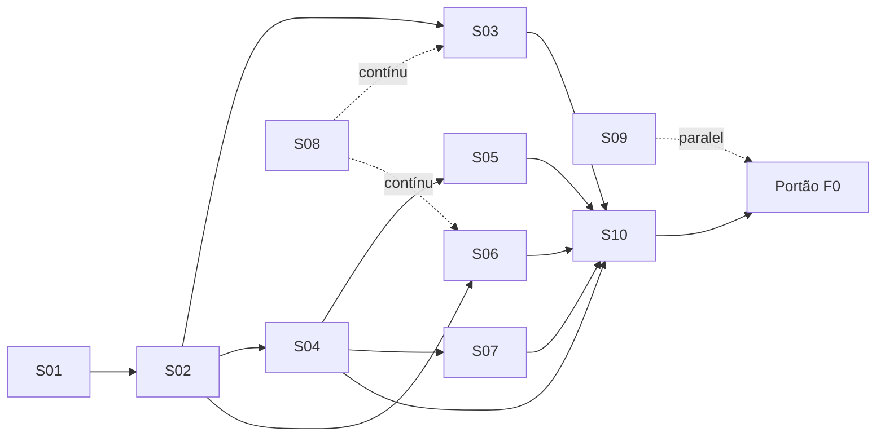

# 03. Fase 0: especificação (provas técnicas)

> Objetivo: responder com números, antes de escrever o produto, às perguntas que podem derrubar o projeto. Duração alvo: 8–16 semanas (Revisão 2: plano Claude Pro; ver `02` §14). Nenhum recurso de usuário final além do app esqueleto.
> Regra: meta não atingida = **parar e reportar** ao PO com opções. Nunca contornar em silêncio.

## 1. Perguntas que a F0 responde
1. O híbrido Python + C++ atinge as metas, ou precisamos de C++ puro?
2. Conseguimos compilar, empacotar e rodar no Windows e no Linux de forma reprodutível (macOS como build de CI melhor esforço)?
3. A viewport aguenta modelos reais com Qt RHI no Windows e no Linux?
4. Conseguimos gerar planta e corte vetoriais aceitáveis do IFC, guardando a vista no arquivo lateral `.obim` com o IFC limpo?
5. O oplog dá undo/autosave confiável? Merge periódico é viável para 2.0?
6. Tipos paramétricos por script geram IFC válido e reeditável?
7. Quanto os agentes realmente produzem por semana e **quanto de cota do Pro cada fatia consome** (calibração)?

## 2. Fatias da F0

### F0-S01. Repositório, licenças e pesquisa (P)
- Repositório (GitHub + espelho Codeberg), AGPL v3, README pt-BR/en, CONTRIBUTING, estrutura mínima de pastas (só o necessário para as provas).
- **Auditoria de licenças documentada** (ficha em `docs/research/`) de: IfcOpenShell, ifcopenshell-python, OCCT, pythonocc-core, Qt 6/PySide6, nanobind/pybind11, ezdxf, LibreDWG, PlaneGCS, libslvs, conda-forge/vcpkg, bibliotecas de PDF. Resultado: tabela "licença / compatível com AGPL v3 / condições".
- Fichas de pesquisa: partir de `07_verificacoes_web.md` (Revisão 2) e reconfirmar com fonte primária (arquivo LICENSE) os itens marcados Parcial ou Não verificado lá, especialmente pacote OCCT no conda-forge, libdxfrw, nanobind/pybind11, PlaneGCS e termos do SINAPI.
- **Aceite:** tabela de licenças revisada pelo papel Arquiteto; nenhuma incompatível sem alternativa.

### F0-S02. CI Windows+Linux + app esqueleto instalável (M→G)
- CI (GitHub Actions) **Windows e Linux obrigatórios** (falha bloqueia merge): build, testes, artefato instalável a cada merge. **macOS melhor esforço**: mesmo workflow, falha não bloqueia, runner menor (3 CPU/7 GB) **[verificado em 2026-10-10]**.
- Teste prático de gravação de vídeo headless dos roteiros (Windows/Linux) **[não verificado]**.
- App esqueleto: janela PySide6 com menu, abre IFC por menu ou arrastar-e-soltar, mostra contagem de elementos e a viewport do S03.
- Pacotes: instalador Windows (MSI ou NSIS), AppImage; DMG não assinado só se sair sem esforço extra.
- **Metas:** build limpo do zero ≤ 60 min no CI (Windows e Linux); build incremental ≤ 10 min; instalador ≤ 600 MB.
- **Aceite pelo PO:** instala no Windows e no Linux sem terminal e abre um IFC público do corpus (ou seu, se já tiver). macOS: sem aceite manual.
- **Decisão produzida:** ADR-005 (dependências: conda-forge vs vcpkg vs híbrido).

### F0-S03. Protótipo de viewport (M)
- Qt RHI (D3D11 no Windows, Vulkan/OpenGL no Linux; Metal no Mac só se compilar no CI). QRhi é API semi-pública (exige `GuiPrivate`) **[verificado em 2026-10-10]**: isolar atrás de interface própria e fixar versão do Qt; tesselação via IfcOpenShell C++ (iterador de geometria multithread), orbitar/pan/zoom, seleção por clique.
- **Metas (portão):**
  | Métrica | Meta | Corpus |
  |---|---|---|
  | Abrir IFC ~100 MB, sem cache | < 60 s | modelo público grande (do PO depois, quando houver) |
  | FPS com ~1 M triângulos | ≥ 30 | idem |
  | Seleção por clique | < 100 ms | idem |
  | RAM | < 6 GB | idem |
  | Funciona no Windows e no Linux, inclusive GPU integrada Intel no Windows | sim | — |
- **Saída:** benchmark reproduzível, relatório com tabela por sistema.

### F0-S04. Ponte Python↔C++ e comparação híbrido vs C++ puro (G) **crítica**
- Construir o mesmo fluxo mínimo de duas formas:
  - **A (híbrido):** PySide6 + ifcopenshell.api criam/editam 200 paredes; o módulo C++ (nanobind ou pybind11) recebe o mesmo `ifcopenshell.file` sem cópia e atualiza a tesselação/viewport.
  - **B (C++ puro):** mesmo fluxo em C++ com IfcOpenShell C++ e Qt Widgets.
- **Metas para o híbrido ser aprovado:**
  | Métrica | Meta |
  |---|---|
  | Compartilhar o mesmo modelo sem cópia entre Python e C++ | demonstrado no Windows e no Linux |
  | Criar 1 parede com camadas e atualizar viewport | < 200 ms (p95) |
  | Editar propriedade de 1 elemento e refletir na UI | < 50 ms |
  | Edição em lote: 1.000 paredes | < 20 s |
  | Viewport não congela durante operação Python longa (GIL liberado) | FPS ≥ 20 durante lote |
  | Diferença vs C++ puro na edição | ≤ 3× mais lento, e dentro das metas absolutas |
  | Linhas de código e tempo de agente para o mesmo fluxo | registrar (critério de produtividade) |
- **Regra de decisão:** híbrido aprovado se atinge as metas absolutas, mesmo que seja mais lento que B. Se falhar em compartilhar o modelo sem cópia de forma estável → C++ puro no núcleo, Python só para plugins/regras.
- **Linha extra opcional (Rust):** só se o oplog/merge em Python (S05) ficar > 10× fora das metas; prototipar o merge em Rust com PyO3 e medir. Não é obrigatória.
- **Saída:** ADR-001 (stack) com números.

### F0-S05. Oplog, undo e merge (M)
- Transações com operações por elemento sobre o mecanismo do próprio ifcopenshell (`begin_transaction`/`end_transaction`/`undo`/`redo`, que existe e é usado pelo Bonsai) **[verificado em 2026-10-10]**, mais uma transação paralela para as operações no arquivo lateral (mesmo padrão do Bonsai para dados fora do IFC). Atenção a falhas conhecidas quando um passo não é registrado (`UndoSystemError` no Bonsai).
- Gravação atômica do par `Casa.ifc` + `Casa.obim` com diário (ver `02` §6.5).
- **Metas:**
  - 10.000 operações aleatórias (IFC e lateral misturados) + desfazer tudo = IFC semanticamente idêntico (ifcdiff vazio) e lateral idêntico.
  - Matar o processo durante a gravação do par: reabrir detecta e recupera um par coerente.
  - Matar o processo no meio de uma sequência: reabrir recupera até a última transação confirmada.
  - Aplicar 1 operação: < 5 ms médio em modelo de 50 MB.
  - **Merge (insumo para 2.0, não portão):** duas cópias com 200 edições cada em elementos disjuntos convergem; edições no mesmo elemento são detectadas como conflito (não resolvidas automaticamente).
- **Saída:** ADR-002 (modelo de dados e oplog).

### F0-S06. Planta e corte (HLR) + vista no arquivo lateral (G) **crítica**
- Dado IFC + plano de corte: SVG/PDF com linhas cortadas (grossas), vistas (médias), hachura de corte por material.
- Comparar abordagens: (a) `SvgSerializer` do IfcOpenShell (C++, usado pelo Bonsai, roda sem viewport sobre `ifcopenshell.geom`; ativo em 2026) **[verificado em 2026-10-10]**; (b) OCCT HLRBRep exato; (c) HLRBRep_PolyAlgo (malha); (d) seção + projeção própria.
- Gravar a vista e uma prancha mínima (1 viewport, carimbo) no `Casa.obim` conforme `02` §6.2; referências por GlobalId; testar os casos da tabela `02` §6.4 (IFC alterado fora, lateral ausente, lateral de outro projeto, GlobalIds trocados com reassociação assistida).
- **Metas:** planta de pavimento 500 m² < 10 s; corte < 10 s; resultado aprovado pelo PO lado a lado com uma prancha de referência (pública, ou dele se já disponível) em 1:50 e 1:100; **o IFC gravado é semanticamente igual ao de antes de criar vistas** (ifcdiff vazio, exceto o pset `OBIM_Projeto`) e passa no validador; os 6 casos de divergência produzem o aviso correto.
- **Saída:** ADR-003 (formato do arquivo lateral `.obim`, pacote `.obimpack`, regras de divergência), ADR-006 (motor de desenho).

### F0-S07. Tipo paramétrico por script (P)
- Janela de correr com parâmetros largura, altura, peitoril, nº de folhas; gerador Python produz geometria; grava IfcWindowType + RepresentationMaps + pset OBIM_Parametric; reabrir e alterar parâmetro regenera.
- **Metas:** 100 combinações sem falha; regeneração < 200 ms; IFC válido; abre com geometria correta no Bonsai.
- **Fora da F0:** solver de restrições (2.0).
- **Saída:** ADR-007 (tipos paramétricos).

### F0-S08. Corpus e gabaritos (P, contínuo)
- **A F0 começa só com IFCs públicos:** arquivos de exemplo da buildingSMART (2x3, 4, 4.3), modelos abertos de tamanhos variados (1, 10, 100 MB), exportações de Bonsai/FreeCAD.
- **Corpus do PO entra depois, sem bloquear nada:** 3 a 5 projetos IFC4 (idealmente também 2x3) + PDFs de prancha, quando ele tiver; ficam fora do repositório público. Ao chegar, cada um ganha manifesto e vira referência de regressão nas fatias seguintes.
- Manifesto por arquivo: origem, licença, esquema, nº de entidades, valores conhecidos (áreas, contagens).
- **Caderno de joins e desenho:** o PO fornece prints/PDFs de 20 situações de parede e 3 pranchas de referência **até a F2-S04** (não é pré-requisito da F0).
- **Aceite:** ≥ 20 arquivos públicos com manifesto; todos com licença conhecida.

### F0-S09. UX com o PO (M)
- Entrevista (1 h) sobre fluxos preferidos do Revit/ArchiCAD; wireframes de janela principal, navegador, propriedades, ferramentas de parede, editor de vista e prancha; 2 rodadas de revisão.
- **Aceite:** PO aprova wireframes. Padrão assumido: híbrido (navegador/propriedades estilo Revit; caixa de ferramentas e "favoritos" estilo ArchiCAD).

### F0-S10. Calibração e portão (P)
- Medir: sessões gastas por fatia vs estimativa, taxa de retrabalho, **uso de cota por modelo e por fatia (semanas 1–4 obrigatórias, `04` §6)**, dias parados por limite.
- Avaliar o gatilho de plano (`04` §6) e levar ao PO.
- Recalcular o calendário do `02` seção 14.

## 3. ADRs obrigatórios ao fim da F0
| ADR | Tema | Origem |
|---|---|---|
| 001 | Stack (híbrido vs C++ puro), ponte (nanobind/pybind11), papel do pythonocc, Rust sim/não | S04 |
| 002 | Modelo de dados, transações e oplog | S05 |
| 003 | Arquivo lateral `.obim`, pacote, divergência | S06 |
| 004 | Threads (UI, geometria, I/O, GIL) | S03/S04 |
| 005 | Dependências e build (conda-forge/vcpkg), empacotamento | S02 |
| 006 | Motor de desenho 2D (HLR) | S06 |
| 007 | Tipos paramétricos | S07 |
| 008 | Estratégia de testes e oráculos | S08 |
| 009 | Licenças e política de conteúdo | S01 |

Formato de cada ADR: contexto, opções, números medidos, decisão, consequências, "o que nos faria mudar de ideia". Resumo de 5 linhas em pt-BR simples para o PO.

## 4. Ordem

## 5. Portão F0: go/no-go
| Resultado | Decisão |
|---|---|
| Todas as metas de portão atingidas | GO: F1 com híbrido |
| S04 falha, demais ok | GO com C++ puro no núcleo (reestimar +20–40% de calendário) |
| S02 (build Windows+Linux) não fecha em 12 semanas | NO-GO parcial: mudar estratégia de dependências antes da F1 (macOS já está fora do caminho crítico) |
| S06 falha (desenho inaceitável) | Pausa: avaliar motor alternativo por 4 semanas antes de qualquer F1 |
| Calibração < 50% da velocidade prevista | GO apenas com novo corte de escopo aprovado pelo PO, ou PO decide subir de plano |

**Pacote do portão para o PO:** instaladores Windows e Linux (DMG experimental se houver), relatório de cota, vídeo de 5 min mostrando cada protótipo, tabela meta × resultado, ADRs resumidos, calendário recalibrado, lista de decisões.
